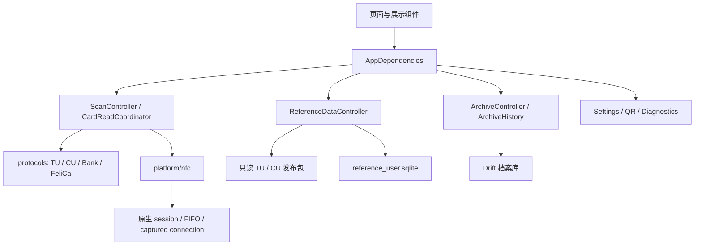

# TrafArch 架构与代码所有权

日期：2026-10-21。批准设计见 `superpowers/specs/2026-10-20-project-refactor-design.md`，实施基线 `8a4818e7d4dc848432a3e39a69195255138a3b95`。本文件描述当前源码；更早的审计 / 合并报告是带日期的历史证据。

## 目录

```text
lib/
  main.dart
  app/                          根组件、依赖装配、主题、导航、版本
  protocols/
    iso7816/                    APDU 模型、交换策略、有界 BER-TLV
    transport/                  平台无关的传输失败
    transit/{tunion,city_union,local,qr}/
    bank/                       EMV / PBOC 枚举、读取、字典接口与领域模型
    felica/                     帧、协议、探测、卡适配器
  platform/{nfc,qr,storage}/     MethodChannel、目录、设置、导出、日志
  features/
    scan/{application,domain}/  会话、采集、协议编排、当前读取展示
    reference_data/             发布包、用户库、查询接口、覆盖范围页面
    archive/                    档案模型、Drift、快照、统一历史查询、详情
    settings/                   设置与诊断控制器及页面
    qr/                         独立扫码页、相机 / 相册获取、字段 / 证书 / 原始数据展示
    transit_analysis/           识别、交易解码、行程分析
    home/                       各卡族独立面板
    expert/                     各文件和原始数据面板
    trips/                      行程条目、筛选、格式化与详情
    cards/                      档案列表
    bank_card/presentation/     银行卡界面
  shared/                       生命周期基类和少量展示常量
android/app/src/main/kotlin/com/kajolno/TrafArch/
  MainActivity.kt
  nfc/                          会话、连接、FIFO 调度、元数据
  platform/                     OnceResult
  qr/                           图片选择
  storage/                      下载目录导出
```

本轮按迁移映射移动 159 个文件，移除旧 `lib/core` / `lib/state` / `lib/database` 中的产品实现；没有建立旧路径转发文件链。现有测试源码的 import 随文件更新，回放传输器只留在 `test/support`。精确映射见 `REFACTOR_FILE_MAP_20261021.json`。

## 依赖与装配

`AppDependencies` 是根装配与展示门面，组合 Scan、ReferenceData、Archive、Settings、QR、Diagnostics 控制器。可变状态、异步工作和资源由各控制器负责。协议代码只依赖 Dart、协议领域模型和注入的传输函数，不反向引用 app、features、Flutter 平台通道或 SQLite。



目录层次不等同于强制编译模块；边界由源码依赖清单和静态检查约束。协议有意保留本地卡特例，没有用同一组默认值抹平不同卡族行为。

## 采集和取消

ScanController 在发现标签前分配 UUID，并把它传到 ISO-DEP / NFC-F 通道。每个异步完成重新核对当前代次；旧结果不能更新新读取。物理指令和响应在采集边界保存不可变副本，后续 APDU 拼接不替代原始帧。原生返回的非空 sessionId 必须匹配。

Android 主线程拥有 session 和回复集合，普通 I/O 走共享单线程队列。取消先从 active 脱离，关闭工作捕获旧 session 的句柄；abort 与最终 sweep 形成 retirement barrier，后续连接等它完成。释放超时和引擎销毁返回明确失败，不冒充物理连接已释放。旧 MethodChannel 名称和旧参数形式保留。

## 协议机制

共享 APDU engine 保留各族自己的 6100 / 6C00 / 6700、GET RESPONSE CLA、Le 修正顺序和资源上限。有效最终命令决定长度校验；Case 3 不把数据尾字节当 Le。共享 BER-TLV 树保留原始值、偏移与错误，深度 / 节点 / 字节有界。

传输失败是 `TransportFailure`；只在平台层把准确的原生异常类映射为卡片离场，通用 TRANSCEIVE_FAILED 保持未知。银行卡保留应用发现证据和每个应用读取结果，终止性通信失败后停止物理 I/O。FeliCa 保留已读取数据、服务访问结果和终止失败；不发明未公开服务。

## 参考数据和档案

发布包在构建时完成来源合并，运行时校验 manifest、大小、SHA256、元数据和必需列，并按内容哈希文件名安装、以只读模式打开。TU / CU 分别加载，任一失败不会阻断另一包。TU 与 CU 的城市命名空间独立，CU 受约束规则必须有对应上下文。歧义、未知、不可用分别表达。

档案有自己的数据库与生命周期。采集时上下文、余额观察、原始帧、解析版本、参考包版本和逐记录来源一起存入快照；展示层的记录抑制不决定归档。`ArchiveHistory` 同时服务详情与导出，不读取当前贴卡对象来补旧档案。时间 / 币种未知显式保留，详见 `MIGRATION.md`。

## 所有权与失败

参考控制器负责关闭 TU、CU 和用户库；初始化结束时若已销毁则立即释放返回资源。AppDependencies 关闭自建档案库前等待已接受的保存，外部注入库由调用者拥有。Notifier 销毁后丢弃通知。设置写入串行排队，读取旧文件失败会传播，完整临时文件写好后才替换正式文件。
