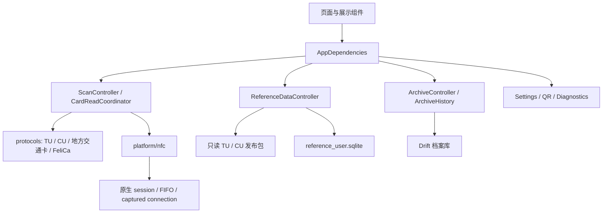

# TrafArch 架构与代码所有权

## 2.x 界面与实卡接入

正式入口 `lib/main.dart` 与实卡测试入口 `lib/main_gallery.dart` 均使用 2.x 协议确认页，再由 `TransitCardAnalyzerApp` 以 `enableLiveBeta` 和 `initialLiveUi` 进入 2.x 实卡界面。1.x 通过设置手动启用，在本次运行中作为备用。切换前等待 NFC 关闭，两套界面共用同一个 `AppDependencies`。实卡测试入口关闭自动更新检查。`InternalPreviewApp` 与样例 fixtures 用于组件测试和设计回归。

2.x 的主题、四项导航和读取交互位于 `lib/gallery/`。实卡模式不加载 fixtures，而是通过 `_GalleryLiveRead` 适配真实 `AppDependencies`：订阅 `watchAllArchiveRows` 生成卡包和历史，把当前 `CardSessionSnapshot` 投影成原预览的首页、行程与专家记录，并把保存、改名、删除、冲突策略、导入导出、诊断和设置动作委托给既有业务层。专家的「交通数据解析」直接消费 1.x 同一套解析结果：余额、币种、卡种与机构字段并入固定展开的「交通应用信息」；0x1A 轨道／公交保留各自原有展开卡，全部 0x1E 记录合并到一张卡并按记录分组，交易明细也合并到一张卡并按交易分组，两类记录整体保持过程记录在前。CU 文件字段继续按 2.x 展开卡片展示。未知值不补猜。失败重读可在首页保留上次摘要，但本次行程和专家不展示旧证据；关闭失败、取消和迟到响应仍由现有会话屏障隔离。

实卡卡包与详情沿用原预览的卡面、列表、统计和冻结交易组件，档案来源是 `SavedCard` 与 `ArchiveHistory` 投影。删除走现有确认流程，导出按当前卡或完整档案写入用户选择的 SAF 位置；消费统计按整数最小单位汇总明确的同币种扣款，CU 复用冻结金额与镜像过滤，不估算未知时间、币种或 Suica 余额差。业务设置同用 `SettingsController`，不写参考包或改档案 schema；卡面与排序持久化未接入。

专家页的“芯片提供机构”和“IC卡提供机构”由 `assets/data/card_provider_registry.json`
提供名称。该 JSON 保留源工作簿 SHA256、149 条来源行和重复备案码；运行时由
`KnowledgeBase` 与参考数据同时加载，更新 TU/CU 的覆盖资源缺失时会回退内置 JSON。
`ResetProviderParser` 按已知复位布局读取两字节 HEX 备案码。交通联合部分实卡
的 ATS 历史字节以 `4D 54` 开头，第 3–4 字节是芯片备案码，第 7–8 字节是 IC
卡备案码。解析器兼容 PC/SC 的 `3B 8n 80 01` 封装，并校验历史字节长度和 TCK。
`CardProviderResolver` 分别查表，明确提取但未收录的备案码显示为「未知（备案码）」，
数据缺失或布局未识别时显示「未提供」。重复备案码列出所有匹配机构。1.x 专家
「信息获取」使用字段行，2.x 使用同一套专家展开卡、字段行、间距和主题颜色。

两套 UI 共用 `QrReadContent`、`QrAcquisition` 与 `QrController`。`AppDependencies.runQrAcquisition` 先等待普通及八达通 NFC 会话关闭，并独占相机／相册获取；离开路由或内存恢复使在途结果失效。2.x 知识库以当前 `KnowledgeBase.packagePaths` 启动后台只读索引；已校验包的实例变更后废弃旧索引，独立预览加载器不参与实卡路径。2.x 的主要页、档案详情、扫码和设置映射为现有恢复路由；恢复只展示冻结读卡证据，不重查参考库或自动归档。诊断由既有 `DiagnosticsController` 写本机文件，反馈只打开用户主动选择的外部链接。

`InternalPreviewApp` 承载样例模式：`GalleryApp` → `GalleryController` / `GalleryQrController` → 合成 fixtures，不连接真实读卡或档案。以下样例、模拟场景和设计回归说明只适用于该宿主的测试路径，不适用于 `lib/main_gallery.dart` 的实卡构建。

Gallery 的关于、问题反馈、致谢与开源许可为独立页面，仍使用 Gallery 主题和导航；许可按需读取 Flutter `LicenseRegistry`。公开联系地址集中在 `shared/app_support.dart`，现有设置页复用。`InternalPreviewApp` 仅注入用户点击时打开公开网页／邮件应用的回调：网页使用既有 `FeedbackBrowser`，邮箱使用 `url_launcher`。不自动访问外链，也不传递卡片、日志或档案数据。底栏共享一个 180ms 水平滑动胶囊，主页面按底栏顺序以 240ms 左右滑动，跨项直达目标。子页面、二维码获取视图与弹层由稳定标识的只读导航栈驱动真实 Navigator 路由，退出内容保留自身展示上下文并停止交互；专家页列表和横向页签使用稳定滚动标识。

Gallery 运行时样式由 GalleryPalette／GalleryTokens、GalleryTypography 和 GalleryCardFace 集中定义，不再消费冻结 fixtures 的旧配色；其资源和业务样例保持独立。真实莫奈仅通过 dynamic_color 1.9.x 的系统颜色通道读取，在前台恢复时刷新；主题逐色插值，首页 SVG 标志映射有效主题色，不接入业务数据库或 NFC。设计依据为根 design.md，长期偏好见 docs/DESIGN_MEMORY.md。

主页面转场协调器只响应底栏点击，保留横向进入／退出、跨项直达与中途反向；正文横滑不再触发功能页切换。页面按稳定 key 构建并沿用 PageStorage，底栏胶囊保留平滑移动，专家内部标签只点击选择，其横向滚动独立消费手势。底栏、列表留白与提示条共用 GalleryNavigationLayout，从根 viewPadding／viewInsets 计算系统导航避让，键盘高度仍由 Scaffold 单独处理；两种底栏按钮行均在系统安全区之上。

可见底栏目的地由 `GalleryController.visibleMainPages` 明确列出首页、行程、专家、卡包四项，不依赖枚举数量计算。足迹前端、主页面分类和冻结场景保留供内部预览，用户场景列表通过 `visibleScenes` 隐藏足迹，不提供设置开关。下沉选中指示器固定使用当前主题色，仅对 alpha 动画，避免透明黑颜色插值造成灰黑中间帧。

`assets/gallery/fixtures.json` 保存 Demo 2.4.0 的 52 个场景、合成卡片／二维码、固定演示时钟及 2026-10-30 知识库快照。专用快照与发布参考数据库分离，由 `dev/gallery/extract_demo.cjs` 离线提取，保留来源哈希，不修改 SQLite 资产或 manifest。相册使用内置样例，导出显示预览；模拟操作和样例设置只存在于内存；“预测性返回手势”是独立的持久化界面偏好，不随恢复样例重置。将来由正式装配层提供展示模型与动作适配器接入业务。

Gallery 预测性返回使用 Flutter 公开的手势生命周期与自定义 PageRoute／PopupRoute：子页面水平跟手，抽屉向下跟手，取消恢复当前路由，提交从当前进度完成并仅返回一次。手势取消不取消二维码获取，真正返回时才取消；获取在手势中完成或场景重置时使旧手势失效。系统减少动画、关闭选项或不支持时保留普通返回，根主页面退出仍由系统处理。

`InternalPreviewApp` 通过既有 `SettingsStore` 注入 `GalleryPreferences` 的读写回调，新增 `gallery_predictive_back_enabled` 文本键（默认开启），不创建数据库。偏好跨新版会话及应用重启保留，读写失败在设置中显示重试入口，串行保存及修订标识防止迟到结果覆盖新选择。Gallery 不直接访问文件；其余新版样例状态仍不持久化。底栏文字、图标使用统一显式颜色动画与固定字重，无投影或触摸状态描边，键盘焦点单独绘制。

Gallery 周统计在独立展示模型中按固定演示周汇总，使用样例的明确币种及最小货币单位；只统计有明确日期的对应币种扣款。人民币／港币保留两位小数，日元使用整数；未知币种保留不可用，不从真实卡号、地区或当前时间推断。

卡包列表与共用大卡面通过纯展示帮助模型 `GalleryBalancePresentation` 分离币种与数字，输入现有余额文本和明确币种代码，统一显示 CNY ¥、JP￥、HK$、USD $、MOP ¥。裸 ¥／$ 不补猜币种；原余额字段、交易明细、导出与周统计接口不受展示格式影响。

Android Gradle 根据 Dart target 的文件名识别 2.x Gallery 构建。Gallery 默认应用 Google Services 插件并包含 Firebase Analytics 依赖；需要完全离线的预览包时可通过 Gradle 属性 `galleryAnalytics=false` 显式关闭。包名、显示名称、原签名和每次打包预留下一构建号的流程保持统一。详见 [GALLERY.md](GALLERY.md)。

Android 版本码直接使用 pubspec 的构建号，`force-version-code-ignoring-abi=true` 固定关闭 Flutter 拆分 APK 的 ABI 偏移；Gradle 拒绝用 false 覆盖，避免 AppInfo、更新比较与安装版本码分离。旧界面和 2.x 关于页统一显示同一个 `AppInfo.buildNumber`，不再对历史 4xxx 产物额外加减 2000。打包前同步 AppInfo、成功打包后预留下一号的机制继续沿用；测试和配置检查不消耗号码。可通过 `dev/gallery/verify_version_codes.gradle` 只读核对 Debug／Profile／Release 各输出的配置版本码，最终交付仍须以 APK/AAB 清单为准。

## 八达通本地余额读取

`AppDependencies` 组合 `OctopusBalanceController`、纯 Dart `OctopusBalanceReader` 与既有专用 `OctopusNfcChannel`。普通 `scanOnce()` 先完成识别和物理 NFC 关闭，识别到八达通后继续读港币余额；两个阶段共用 `scanning` 状态与首页同一个读取按钮。普通关闭失败保留基础信息并阻止后续会话。设置页不再提供官方联网开关或同意弹窗，旧的启用／同意设置不再参与读取；旧官方 OCAP、HTTP、登记和更新汇率运行代码已退役。

本地读取只使用两帧：Polling `8008`，然后 Read Without Encryption 服务 `0117`、块列表元素 `8000`。余额位于返回的 16 字节块字节 2..3，按 `(raw - 350) × 10` 得到港币分；不经过浮点、不发网络请求、不写卡。所有响应校验 LEN、响应码、每个应答的 IDm、状态字节与块数。

余额读取成功后，本次 HKD 读数还会以 `VerifiedAccountBalance` 写入该次读取的档案快照，卡包与历史显示港币；TU 原始 `balanceFen` 与 CNY 币种保持不变。

余额结果仅包含 HKD 最小货币单位、当前 NFC-F IDm 与读取时间。`AppDependencies.currentOctopusResult` 同时核对本次 `ScanPresentation` 和控制器结果对象。新普通扫描清除旧绑定；停止、切页、下一次扫描、销毁和内存恢复会作废在途请求。控制器先暂存余额，确认同一会话物理关闭后才发布；关闭失败保持 busy、保留关闭错误并阻止新会话，停止操作可重试关闭。取消期间的响应和关闭确认均不能恢复已作废结果。

已有明确 `0x8008` NFC-F IDm 时，通过 `expectedCardIdm` 核对第二阶段，协议同时校验每个应答的 IDm。只有 TU 结果时，没有已验证的 TU 卡号与 NFC-F IDm 映射；此时组合显示依赖用户按提示保持同一张卡连续读取，不能宣称已完成跨接口身份验证。不会根据卡号格式猜测映射，也不会把 TU 金额换标签或用汇率倒算港币余额。

余额控制器只允许结构有效的只读 NFC-F 命令：`0x8008` Polling、Request Service、Request Response、Read Without Encryption、Request System Code；禁止认证、写入及未知命令。请求发送前复制并冻结，防止排队期间变更。专用原生通道继续使用同一 sessionId、`frame` 参数、共享物理关闭屏障、500 ms presence-check 与受会话保护的 disable→enable 发现切换；不修改普通扫描或 Suica 读取。原生发现期限 55 秒、Dart 发现兜底 60 秒、余额操作上限 20 秒。

诊断沿用既有本地开关及导出，只记录阶段、命令码、长度、耗时和白名单错误码；不记录余额、IDm、完整帧、异常原文或任何网络输入。日志异常不改变读卡或释放流程。

首页「最近扫描」与行程顶部摘要使用相同 `octopusBalanceText`、`octopusReadNotice`。港币来自本次成功结果，括号内金额来自原始 TU 读取，如 `HK$50.00 (￥42.05)`；港币失败时明确保持未读取，TU 缺失时不补括号或零。行程即使没有记录也保留卡片摘要。所有汇率数值、更新按钮、独立在线面板与联网设置已移除；通用 FeliCa 摘要也不再渲染旧快照的汇率数值。旧档案、快照模型和数据库资产不改写。

## 小窗与分屏布局

Android 主 Activity 显式声明 `resizeableActivity=true`，沿用 Flutter embedding 处理窗口尺寸、方向与密度配置变化。界面按当前 Flutter 窗口约束布局，不锁定设备方向。卡片 JSON 导出和日志管理器使用可滚动的 AlertDialog，将标题、说明及选项放在同一滚动区域，操作按钮留在底部；导出模式根据窗口可用宽度和字体缩放改为纵向排列。悬浮导航在可用宽度不足以容纳四项及选中文字时改用等宽图标，保留选中态和语义标签，宽度恢复后显示文字。窗口调整不重建应用依赖，也不清空当前页签和弹窗选择。自动化窗口回归不替代厂商真机的标题栏、相机资源争用与 NFC 焦点切换验收。

## 内存预警与现场恢复

`TrafArchApplication` 持有 `HonorMemoryCoordinator`，通过 Application context 动态注册荣耀 `itgsa.intent.action.TRIM`／`KILL`；Android 13+ 使用 `RECEIVER_EXPORTED`，不绑定 Activity 生命周期。每条通知以类型、ID 和 Binder 隔离，接收器工作线程在 2.4 秒内完成一次回报；Flutter 未就绪、超时或写入失败回报失败。Binder 使用 `FIRST_CALL_TRANSACTION`、oneway，参数依次为 notifyType／notifyId／result／Bundle，不读取 one-way 回复。此公开广播协议未提供可验证的发送方权限；严格校验载荷，收到 KILL 只本地保存和中止读卡，不主动退出、不上传数据。

独立通道 `transit_card_analyzer/memory` 的原生→Dart `onMemoryPressure({'kill': bool, 'expiresAtMillis': int})` 返回 bool；原生 UI 队列与 Dart 消息队列均拒绝已过期通知。Dart→原生 `readRecovery`／`writeRecovery({'content': String})`／`clearRecovery` 只操作 `noBackupFilesDir/memory_recovery.json`。Android `AtomicFile` 发布完整文件，限制 UTF-8 8 MiB，不进入系统备份；有效期 24 小时，读取成功后消费，损坏／过期文件清理，新读取和确认操作作废旧现场。没有新增 SQLite 文件、表、迁移或后台服务。

`AppDependencies` 将 TRIM 与 `WidgetsBindingObserver.didHaveMemoryPressure` 统一为可重建缓存清理；不销毁借给当前展示的参考库连接，不删除原始帧／日志／未保存结果。KILL 同步失效当前读卡代次，发起但不等待物理 NFC 关闭；现场写入、诊断及已接受档案操作使用独立 1.8 秒等待预算，超时如实返回失败。恢复启动就绪前不自动扫描。恢复主 Tab、设置／二维码／档案详情入口及行程筛选；临时弹窗返回父页面，不恢复相机或 NFC 句柄。交通卡沿用捕获快照的历史展示器，FeliCa 保留已读字段与物理证据，不重跑协议、匹配或自动归档。恢复文件保留快照原文；待保存内容由恢复面板显式确认，沿用原读取时间和捕获解析版本，新档案继续执行既有保存观察元数据策略。

## Amusement IC Access Code

`FelicaReader` 对 Android 已选的 `88B4` 系统，或 PMm IC Type 为 `F0/F1`
的 Lite/Lite-S，使用明确的系统 Polling，跳过不受支持的 Request System Code。
普通 FeliCa 保持原有系统发现；若发现列表选中了 AIC 适配器，则先重新 Polling
`88B4` 并使用该响应的 IDm 读块，不借用其他系统的 IDm。

`AmusementIcAdapter` 仅通过服务 `000B` 依次读 `82` 身份块和 `00` SPAD0。
系统码仅为候选；身份块 DFC 确认发行方后才读取 SPAD0，未知 DFC 只保留证据。
纯 Dart `AmusementIcParser` 解码 20 位 Access Code，校验版本、BCD 和公司前缀；
适配器再核对前缀与 DFC。格式检查不代表发行方校验和或卡片真实性验证。
公开逆表隔离在 MPL-2.0 文件，出处和许可随应用打包并注册到开源许可列表。

`AmusementIcData` 独立保存 Access Code、发行品牌、DFC 和原始块，不替代 IDm
或逻辑交通卡号，不生成钱包、余额或行程。主页和专家页共享可选择复制的字段；
本地诊断与恢复现场冻结同一结果，恢复时不重新解码、读卡或自动归档。
旧版非 AIC 的 MIFARE 卡不在此读取路径范围内。

`captureAmusementIcArchive` 将已确认的 Code 和发行品牌共同保存到 v3 快照的
`amusementIc` 扩展，复用手动确认、自动保存与恢复后确认保存。指纹使用
`felica:amusement_ic:access-code:<20 digits>`，RF IDm 变化不产生重复卡片；
未读到有效 Code 或品牌时不创建或覆盖档案。卡号、余额、币种、交易条数保持未知，
数据库结构不变，完整备份保存快照原文及批次。

`projectAmusementIcArchive` 核对卡型、扩展版本、身份上下文和指纹，从同一个
历史批次恢复 Code 与品牌；未来或损坏格式保留诊断并可回退旧有效批次，不跨批次
拼接字段。卡包详情显示冻结身份与读取时间，可选择品牌、复制完整 Code，并保留
用户自定义名称及历史证据，不显示交通余额或空行程占位。

卡包列表、详情与保存确认的默认名称统一为 `Amusement IC ( 发行品牌 )`，
由 `AmusementIcArchiveIdentity` 从有效冻结资料派生，不回写旧档案名称。
自定义名优先，副标题保留完整默认名。卡号位置显示五组四位的 Access Code；
详情与保存确认只显示分组号码，复制仍为连续20位。列表在已有完整历史投影中
恢复品牌和号码，身份值相等参与流去重；无有效快照时明确未知，不借标量品牌
或IDm拼接身份。实时读卡与恢复摘要保持原先的原码展示。

## Suica 历史与离线站名

`SuicaAdapter` 在已验证的 `0x090F` 服务中读取块 0..19；块 0 同时提供
当前余额与最新历史，保留单次读取结果，不重复发请求或读取越界块 20。
读取中断保留成功块。`SuicaRecordParser` 只解析原始字段，
`SuicaTransactionDetails` 区分物理块号与卡内 16 位流水号、铁路/公交/购物/
特殊/未知布局、时间精度和站点状态；只有同次读取中物理相邻、有效且流水
严格正向的记录提供独立余额差。卡内流水允许跳号，但缺块、无效字段、日期
倒序、流水重复/倒退/回绕和最旧记录不猜差额。交易金额原字段仍是交易后余额，
币种明确为 JPY。

`KnowledgeBase` 独立加载 `SuicaStationRepository`，读取经 SHA256 校验的
`assets/suica/suica_stationcode.db`。此原库来自用户提供的 Suica Reader APK，
由 `dev/suica/publish_suica.py` 离线原样提取；原表、索引和 6435 条记录不改。
查询使用区域、线路、站点三键；特殊端点、未匹配及歧义均不补猜站名。
源库三键采用小写、不补零的十六进制文本语义：虽然列声明 INTEGER，
SQLite 会将纯数字键存为整数、含 a–f 的键存为文本。运行时必须把协议字节
转换为十六进制字符串参数，不能直接绑定十进制整数，否则会漏匹配或选错站。
加载失败只令 Suica 站名不可用，不影响原码解析及 TU/CU 数据。

`ScanPresentation` 在读卡完成后生成 `SuicaTripPresentation`，现有行程页使用
`SuicaTripList` 展示全部记录。每条铁路记录的两端来自同一原块，不跨记录配对；
只有日期的记录不显示假定的时分。首页和专家摘要显示最近五条，并指向行程页。
Suica 行程的地区标签为“日本”；090F 铁路履历有有效日期但没有时分时显示
“仅记录日期”，列表说明当前履历不含进出站时刻。购物记录有明确时分时照常显示。
行程票卡复用国内交通卡的底部布局，显示带正负号的 `JP￥` 金额与“行程后余额”，
不提供席别或商务座判断；余额已知时独立显示，金额未知不再将余额隐藏。
“余额差”来源说明保留在详情与冻结 JSON 中，票卡只去掉金额的说明前缀；
旧捕获不重新解析、不跨批次补算金额。国内进行中行程继续不显示最终金额与余额。
当前未读取另一个 108F 闸机记录服务，不将其可能提供的少量近期时刻推定到090F历史。
内存恢复冻结已解析字段、站名、参考包哈希和展示投影，重启不重跑解析或查库；
诊断包含原字段与展示投影。Suica 通过独立的 `felica:suica:idm:<16 HEX>`
本地指纹关联同一卡片，严格校验 IDm，逻辑卡号仍为 null，不把 IDm 当卡号。
档案使用既有 v3 快照的 `suica` v1 扩展保存原始块、状态、日期精度及冻结行程，
不改 SQLite 表结构；JPY 最小单位为整数日元，context 小数位为 0，展示统一 `JP￥`。
历史投影仅恢复捕获时站名，跨批次凭完整原始记录和卡内流水证据去重，不依靠会移动的块号，
同批重复出现保留次数。卡包详情、累计计数、字段 JSON 与文本导出消费同一投影；
余额差不当作票价，读取失败不冒充空历史。完整备份保留所有捕获原文。

Suica 的公开 IDm 与卡面 IDi（例如 JE 开头编号）分开显示。卡面编号位于
加密区域，当前无密读取不提供该字段；缺少 IDi 不标成“本次卡号未读到”。
档案展示核对已保存的 IDm 与指纹，冲突时显示标识异常，不任取一个值。
用户可在卡包详情填写、修改、清除和复制卡面编号，独立标为“手工填写”。
显示格式为首组两字母加三位数字，后续三组各四位，例如 `JE123 4567 8901 2345`；
不采用 Access Code 的每四位均分规则，复制时保留连续完整编号。
`CardArchiveDocument.cardExtensions.suicaManualNumber` v1 保存 `source: user`、
规范化的 `value` 和 `updatedAt`；不占用已观察的 `cardNumber`、不修改指纹、
读取时间、行程快照或批次。清除保存 `value: null`，重复刷卡与改名保留用户字段。
完整备份携带此扩展；不同手工值沿用档案的显式冲突保护，旧备份不能静默覆盖修改
或恢复已清除编号。不支持的扩展版本或损坏字段保留原文，拒绝覆盖。

090F 未使用槽位除全零外，还可为完整16字节且仅第4字节为 `80` 的初始化模式。
`SuicaRecordParser.isBlankHistoryBlock` 仅匹配这两种模式，不按未知日期、零余额
或未知处理码过滤。实时交易与旧档案展示共用判定，所有原始块、旧记录快照仍保留。
结构化导出和已保存计数跟随投影过滤；已完整观察但仅包含空槽的旧档案显示0条，
未成功观察历史时仍显示未知，不将读取失败视为空历史。

## JSON 档案与文件交换

`CardArchiveDocument` v1 是按卡片保存的完整 JSON 表示；数据库 v7 的 `archive_documents` 保存文档，原摘要、批次和观察时间表继续承担索引及事务写入。升级在同一事务内补齐旧档案，保留读取快照 v1/v2/v3 原文；文档格式版本、SQLite schema 与解析版本分别演进。旧调用方直接写索引时由触发器标记文档过期，仓库读取前事务刷新，保留导入行和未知扩展。

UI → `AppDependencies.archiveTransfer` → `ArchiveTransferController` → `CardRepository` / `ArchiveDocumentStore`（平台）负责导入导出。文件通道 `transit_card_analyzer/archive_documents` 的 `openJson` / `saveJson` 调用 Android SAF，读取和写入严格 UTF-8，32 MiB 上限；取消返回 null，错误不报告成功。应用关闭等待已开始的操作，选择器迟到结果不能启动导入。

完整备份以 `trafarch.archive` 封装完整卡片文档；字段导出使用独立 `trafarch.records` 平铺投影，不调用快照原文的 encode 来裁剪。TU/CU 各用冻结数据生成记录，只有已保存的确定关联才合并。字段文件导入在独立身份命名空间保存，不推断 NFC 身份、币种或缺失的字段。格式、字段和示例见 [JSON_ARCHIVE_FORMAT.md](JSON_ARCHIVE_FORMAT.md)。

合并时被替换的原始摘要保存在 `retainedSummaries`，按稳定身份进入历史与字段导出投影，来源为 `imported_summary`；不写成 NFC 读取批次，也不作为余额来源的批次证明。摘要字段与其观察时间一起选取，完整导入显式写入 null 并同步观察时间索引，避免刷新复活旧币种或旧时钟。

卡片列表与详情的 `ArchiveRecordCount` 复用 `projectArchiveRecords` 的去重记录行计数，不修改 `SavedCard.transactionCount`（最近一次交易文件观察数量）。计数包含 TU、CU、字段导入及保留摘要；上海 CU 镜像保留独立来源行，不等于票卡数量。旧数字摘要无明细时明确回退“最近读取交易”。`watchArchiveCardSummaries` 使用仓库单个 joined 订阅监听卡片与批次，在事务中批量读取文档与索引；clean 文档为权威，dirty 文档采用当前索引并保留 JSON 独有字段。每卡文档或输入投影错误只令该卡记录数待核实。列表 state 保存流，重建不重复订阅。

日期：2026-10-21。批准设计见 `superpowers/specs/2026-10-20-project-refactor-design.md`，实施基线 `8a4818e7d4dc848432a3e39a69195255138a3b95`。本文件描述当前源码；更早的审计 / 合并报告是带日期的历史证据。

## 目录

`features/trips/journey_presentation.dart` 负责纯展示投影，live 与 archive adapter 分别提供当前与捕获时的证据。只有同应用、币种、时钟、方式和共同读取批次内的明确进出事件才可配对，两端分别需要有效受理城市，允许城市不同；依据为唯一同一 1A、相邻连续交易序号或可靠连续 1E 原始槽位。公交还要求相同非空线路。跨城 `isCrossCity` 从有效两端城市派生，标题省略单一城市前缀；同城异地卡不省略城市。相邻序号及槽位配对不能跳过未知或中间记录，明确同一应用记录的双侧沿用自身关系。不能使用过滤后的列表序号代替原始槽位。各侧 payload 保留独立详情；票卡数量不替代交易笔数，UI 筛选不重新配对。

实时和档案共用的 `TripCardsView` 将 TU `0x18` 确认消费按时间列入历史行程，即使交通方式未知也保留独立交易卡。来源筛选仍按 `0x18` 交易，未知方式仍可用“其他”筛选。分组使用已观测消费证据，城市、线路、站点与进出站继续以卡内字段和参考匹配为准。

`trip_journey_evidence.dart` 和归档 adapter 仅在已保存关联的时间、城市、方式、角色、金额与唯一性均通过时，把原始 1E 槽位传给交易代表事件；POS 包含关系本身不建立行程。交易序号与物理槽位是独立证据，两个已知交易的序号缺口不能被槽位覆盖。1A/1E 同侧另需有效且严格相等的完整终端号；公交上车不使用标注金额作为扣款。模型在配对前折叠不同来源家族的已验证同侧操作，保留每个原始 `JourneyEvent`，详情和来源筛选仍可访问全部 payload。归档关联逐批次证明，不能经合并历史借用另一批次的身份。

轨道 `0x07`／`0x08` 与明确的补票状态映射到独立 `fareAdjustment`，不转换为普通进站。补票与出站仅走相邻连续证据路径，不走 1A 普通进出站关系；同钱包共同批次内，前一出站之后若已有未闭合进站或另一补票，则不能选取当前补票替代起点。可靠的连续交易序号也不能覆盖已知槽位冲突。补票配对保留各侧原始事件，`start` 仅表示补票地点与时间，`startsWithFareAdjustment` 控制补票站名右上角的小字标签；孤立补票根据事件角色复用同一站名组件，`duration` 留空。补票金额由 `fareAdjustmentAmountText` 独立传给卡片，`amountText` 仍是出站金额。行程后余额只沿用已确认的出站余额，补票不参与普通进站或公交的局部余额闭合。仅此展示投影变化不升级捕获解析版本、不改写快照或 JSON。

TU 0x18 与 1E/1A 的展示关联按来源分别执行两轮：先在全部事件间分配秒级时间对应，再对未使用的双方按有效 POS 包含关系补缺；同强度候选保持原顺序。重复使用同一终端时，POS 不能抢占其他事件的精确时间对应。该展示策略从解析口径 v11 起保存，余额仍使用独立的严格时间、金额、方向与双向唯一验证，旧快照不重新关联。

TU 1E 金额与记录余额默认按大端解析。v12 起，`TUnionProcessParser` 仅对同时满足 EP 进出站类型 `03/04`、轨道应用分类 `01`、受理城市 `2210`、终端前缀 `22104131`、收单机构 `1217221000000000` 的已核实沈阳格式采用小端；判断逐条使用受理方原始证据，与发卡地区无关，不以金额大小切换。该格式与同卡的大端 EC 轨道、EP 公交可以共存。原始 HEX、站点字段及币种不变，金额与余额解析值统一进入实时分析、新批次、历史投影与字段 JSON；旧档案继续消费捕获字段，不调用新解析器重写。记录余额的字节序修正不证明它是交易后余额，行程余额仍须通过下述独立局部证据核验。

行程余额投影的 `walletDeltaFen` 仅由明确的 0x18 消费或充值提供，且要求该笔余额已由钱包连续账本确认；归档还须全部来源版本不低于 v8 并显式保存 `balanceAfterIsRecorded=false`，旧展示兼容值不能成为新的独立佐证。对进出原始余额相同的完整行程，允许通过同批次唯一相邻的下一笔 1E 消费局部闭合：该消费须精确继承 0x18 关联和物理槽，原始记录余额等于已确认扣后余额，金额及有符号变化一致；区间内只准同钱包、同批次、同时钟的明确充值，每笔充值后的确认余额必须与累加结果一致。未知时间、同刻事件、缺槽、重复、未知操作或金额冲突均拒绝，不把充值前的候选余额用于延伸整条 1E 账本。单次公交 05/06 可通过与进出站相同的精确唯一验证继承原始槽位，不因此获得 1A 身份或参与进出站配对。此为展示投影增强，解析版本保持 v12，原始快照、HEX 和字段 JSON 的记录余额不改写。

`reference_data/domain/tu_cycle_station_resolver.dart` 统一当前展示、交易分析与新快照捕获的 TU 轨道查询。原始最长前缀结果若只有线路而无站名，仅可使用既有严格片段匹配补全同一原始来源和前缀内的站点；输入还须逐字符符合原线路字节与原站点字节各自后补 `00` 的格式，不丢弃未知站码或非零低字节，不转换原码进制。完整匹配、歧义和查询错误保持优先，未知站点不填默认值。SQLite 和 manifest 不因此改写，补全结果保留线路前缀与站点原始键的证据。历史档案仍按捕获值展示。

北京 TU `appTypeCode=00` 另有只用于地点查询的来源例外：城市必须为 `1000`，合法 16 位 HEX 终端须以 `0000` 开头，且 TripReader `m750d` 的原终端前缀分类明确为轨道。仅查询原始 `city + pos` 来源键，不启用片段兜底；例如终端分类键 `1000300` 与地点键 `1000040041` 使真实 `040041002C0000` 记录显示“4号线 / 角门西”。分类码、资金类型和原始记录不变，关联交易不因该地点赋予轨道 `stationType`，独立事件仍是 `other/unknown`，不将 `type06` 解释为退资。解析口径 v10 捕获新地点；归档普通卡和行程适配均消费 `capturedDisplay`，旧档案不重新查询参考库。

独立 1A 按两侧各自的城市、线路、站点和时间保存 `capturedDisplay`；独立 1E 保存本条记录的显示结果。归档消费捕获值，不用当前参考库重算。交易的 `resolvedBusLineLabel` 只来自公交解码／匹配结果，随 `capturedDisplay.line` 保存；票卡只为这种已解码数字线路添加“路”，原始线路码及前导零保持原样。历史身份比较忽略新增的 `capturedDisplay` 显示元数据，原字段与全部来源批次仍完整保留；其他未知原字段继续参与精确比较。

完成行程的金额和席别取出站事件，行程后余额优先采用已确认的出站交易后余额；v8+ 捕获仍须显式 `balanceAfterIsRecorded: false`。独立 1E 另以 `JourneyProcessBalanceEvidence` 传递原始金额、余额和自身来源槽位，在共享投影内逐行程验证：明确配对且同批次唯一可靠连续槽，进站金额为零，进出记录余额之差等于出站扣款时采用出站余额；两端余额相等时，还须更晚相邻 1E 的零金额进站余额等于原余额减扣款，并拒绝两个证据区间内的其他操作。同批次未知时间事件也阻断。只适用于已确认人民币直接钱包；1A 原始余额、未知解释、跨批次及冲突不提供证据。同侧折叠前按余额原事件的来源与槽位过滤，防止合并来源借证。不能沿 1E 全链倒推，因充值可能不写入 1E；单侧记录不凭原始余额直接生成行程后余额，单次公交仅适用下述独立局部闭合规则；进行中记录始终隐藏行程后余额。实时和档案共享此展示规则，旧档案有足够来源证明时可重新投影；不改写原始字段、快照 JSON、导出语义、数据库结构或捕获解析版本。仅有进站事件时隐藏金额、行程后余额与席别。用户确认的大兴机场线人民币 5000 分消费规则通过 `journeySeatLabel` 同时用于 live/archive；深圳 11 号线仍无启用规则。合并历史的显示字段和上下文均取最新捕获，各来源保留自己的参考包版本。

上海专用分析在缺少 1E/1A 注解时可匹配 CU 2000 终端资料，显示仍使用 TU 2900，账本和钱包保持 TU 来源。方向推断来源 `shanghai-cu-ledger-inference` 随 v9 解析结果保存，详情明确显示；旧余额版本阈值不变。上海镜像记录仅在展示层折叠，归档需所有来源批次均提供严格匹配的 TU 记录；原快照、CU 来源和导出不变。

独立单次公交须由同钱包、同批次的前后相邻物理槽形成局部余额闭合：前一完整行程的零金额进站余额减该行程扣款，必须等于其出站记录余额；该出站余额再减单次公交扣款，必须等于后一零金额进站的记录余额。单次记录原值须等于本次扣前或扣后值。仅有后一条锚不足以核实余额，因为充值可能不写入 1E。全部槽位须唯一可靠，所有区间均拒绝已知中间操作及同批次未知时间事件；受理城市可以不同，已确认数值冲突、未知币种及缺槽继续阻断。该结果仅为保存记录的局部闭合投影，不声称补齐卡片未保存的资金事件。原始记录余额保留，配对详情另外标注出站后余额。

旧档案仅在同批次物理帧足以证明目标 TU AID 的 SELECT 与成功 `00 B2 slot F4 Le` 响应时，派生可靠 1E 槽位来源。响应需与记录原始 HEX 唯一一致；仅有旧 `tu_process_record` 的自动编号或 `cycle[]` 下标不足以证明槽位。会话、帧顺序、应用选择、重复槽位／响应及明确不可靠标志都参与拒绝判定。该来源用于历史投影，快照、原始 HEX、捕获版本及 JSON 导出原文不被升级或改写。

```text
lib/
  main.dart
  app/                          根组件、依赖装配、主题、导航、版本
  protocols/
    iso7816/                    APDU 模型、交换策略、有界 BER-TLV
    transport/                  平台无关的传输失败
    transit/{tunion,city_union,local,qr}/
    felica/                     帧、协议、探测、卡适配器
  platform/{nfc,qr,storage,browser}/ MethodChannel、目录、设置、导出、日志、反馈浏览器
  features/
    scan/{application,domain}/  会话、采集、协议编排、当前读取展示
    reference_data/             发布包、用户库、查询接口、覆盖范围页面
    archive/                    档案模型、Drift、快照、统一历史查询、详情
    settings/                   设置与诊断控制器及页面
    qr/                         独立扫码页、相机 / 相册获取、字段 / 证书 / 原始数据展示
    transit_analysis/           识别、交易解码、行程分析
    home/                       各卡族独立面板
    expert/                     各文件和原始数据面板
    trips/                      行程条目、筛选、格式化与详情
    cards/                      档案列表
  shared/                       生命周期基类和少量展示常量
android/app/src/main/kotlin/com/kajolno/TrafArch/
  MainActivity.kt
  browser/                      Custom Tabs 支持检测与默认浏览器回退
  nfc/                          会话、连接、FIFO 调度、元数据
  platform/                     OnceResult
  qr/                           图片选择
  storage/                      下载目录导出
```

本轮按迁移映射移动 159 个文件，移除旧 `lib/core` / `lib/state` / `lib/database` 中的产品实现；没有建立旧路径转发文件链。现有测试源码的 import 随文件更新，回放传输器只留在 `test/support`。精确映射见 `REFACTOR_FILE_MAP_20261021.json`。

## 依赖与装配

### 边到边显示与系统安全区域

Android targetSdk 保持 37，遵守 Android 15 起强制边到边显示的要求，不设置退出项。`main.dart` 显式启用 `SystemUiMode.edgeToEdge`，Android 30+ 明暗两套 LaunchTheme／NormalTheme 均声明 `windowLayoutInDisplayCutoutMode=always`，启动窗口与 Flutter 内容一致允许延伸至刘海区域。

`MaterialApp.builder` 通过 `AnnotatedRegion<SystemUiOverlayStyle>` 根据实际主题背景设置导航栏图标亮度，AppBar／SliverAppBar 继续根据自身背景决定状态栏图标；黑色扫码页面单独声明浅色系统栏图标，退出后由当前页面恢复。透明系统栏颜色仅用于兼容较旧 Android，不依赖 Android 15 已停用的栏颜色 API 防遮挡；三按钮导航保留系统对比度保护，手势导航保持透明。

交互内容根据 `MediaQuery` 的当前窗口安全区域避让系统栏及刘海：AppBar／SliverAppBar 处理顶部，正文 SafeArea 处理侧边与底部，悬浮导航使用底栏库已有的 SafeArea，避免重复叠加。记录详情弹层除 `useSafeArea: true` 外，还在内容外补充底部 SafeArea（框架的该参数只保护顶部和侧边）；档案批次诊断及恢复原始数据页同样使用 FoldSafePage 与正文 SafeArea。回归覆盖手势／三按钮的底部边距、横屏侧边刘海、明暗主题切换、扫码进退及弹层最后操作可点击；真实 Android 15+ 设备的系统栏与启动画面仍需设备验收。

规范来源：https://developer.android.com/about/versions/15/behavior-changes-15#edge-to-edge

### 窗口与折叠屏布局

展示层 `shared/presentation/adaptive_layout.dart` 结合 ITGSA 大屏白皮书 2.2／4.2／4.4 和 Android 列表详情布局按当前窗口逻辑像素适配内容。手机、平板、横屏及分屏统一使用居中的悬浮胶囊底栏，沿用 280dp 宽度上限、56dp 高度、28dp 圆角与距系统安全区 20dp 的间距；窄窗及大字体沿用等宽图标收缩，滚动显隐与子页面返回回显保持一致。壳页不创建侧边导航及竖分隔线，状态栏背景保持连续；AppBar／SliverAppBar 独立处理顶部安全区，不额外增加一层顶部留白。主页面 IndexedStack 与底栏始终挂载在同一容器，窗口缩放不重建控制器或等待中的 NFC；主页面统一预留悬浮底栏留白，独立档案详情路由不预留主导航高度。首页在正文可用宽度至少 840 时左右排布，顺序列表及设置内容限宽。

专家页与二维码结果页共用 `ExpertField`，字段名后统一显示中文冒号，字段标签和值通过 Wrap 按实际文字及当前字体缩放宽度排布，不按窗口断点强制上下排列，也不为短标签预留固定宽列。能容纳的字段保持同行；长值移到下一行并获得完整正文宽度，允许自然换行，不截断公钥、HEX、账户或诊断原文。

`AdaptiveCardDetailPage` 在同一路由保存当前卡片 ID，`AdaptiveListDetail` 在可用宽度至少 840 且高度至少 480 时并列列表和详情；窄窗仅显示已选择详情，系统返回退出详情路由。列表与详情窗格通过稳定 key、Offstage 保持挂载，详情的查询流、筛选和滚动不因窗口缩放重新创建；各窗格独立 ScaffoldMessenger，避免同一 SnackBar 同时注册多个 Hero。已存在的本地恢复继续保存选中卡片路径与筛选，不写入新的数据库字段。

折叠屏只按折叠与展开后的当前窗口尺寸适配外屏／内屏，不识别半折、书本或桌面姿态，不根据折叠角度切换布局。`MaterialApp.builder` 在 Navigator 与 Overlay 外统一注入 `FoldableDisplayScope`，从布局使用的 `MediaQuery.displayFeatures` 中过滤 fold 折痕及零面积特征，完整页面与列表详情组件也应用同一规则；主页面、路由、Dialog 与 BottomSheet 均不因半折信号缩至半屏或重新分栏。实体铰链及刘海仍按真实遮挡区域避让，完整页面通过 DisplayFeatureSubScreen 更新可用子屏和局部 MediaQuery，列表详情仅可沿满足两侧最小宽度的实体竖向铰链分栏，其余按当前可用宽高布局。行程面板保留触发 anchorPoint 与 useSafeArea，对话框最大宽度 560。Android 17／targetSdk 37 不添加限制旋转／缩放的兼容退出项，不接入厂商平行视窗或 Activity Embedding 来拆分同一 Flutter 引擎。

扫码页拥有外部 MobileScannerController，因此自行监听 WidgetsBinding 生命周期，将相机 stop/start 串行化，处理权限请求尚未结束时进入 inactive 的情况，失败后允许用户重试；窗口布局变化不重建相机控制器。预览比例和旋转交给现有 CameraX／mobile_scanner，NFC 通道与会话契约保持不变。模拟回归不能证明厂商内外屏、相机独占资源、物理 NFC 连接或系统强杀行为，仍需真机验收。

2.x Gallery 使用独立 `GalleryWindow`，置于 MaterialApp.builder 的 Navigator／Overlay 外，复用 FoldableDisplayScope 过滤折痕。实体铰链分隔时选最大子屏，等面积优先左／上；通过 removeDisplayFeatures 调整 Insets 后显式更新 MediaQuery.size，背景保持全窗口主题色。标题和正文限宽 720dp，悬浮导航 320dp、下沉按钮区域 720dp，不引入双栏。布局缩放保持 GalleryController 和路由身份；展示层锚点注册表按布局、滚动和窗口指标变化重测，GalleryRouteEntry 的可选 anchorId 连接真实触发器，原 anchor 仅为无触发器样例提供回退。Flutter embedding 已合并 captionBar 到系统安全区，不新增原生桥接；Gallery 仍为隔离样例，不改变 NFC、相机或进程恢复政策。相关行为与尺寸回归见 gallery_window_layout_test。

规范来源：
- https://www.itgsa.com/documents/5242001394058240
- https://developer.android.com/develop/ui/compose/layouts/adaptive/list-detail
- https://developer.android.com/develop/ui/compose/layouts/adaptive/foldables/make-your-app-fold-aware
- https://developer.android.com/about/versions/17/changes/ff-restrictions-ignored

`AppDependencies` 是根装配与展示门面，组合 Scan、ReferenceData、Archive、Settings、QR、Diagnostics 控制器。可变状态、异步工作和资源由各控制器负责。协议代码只依赖 Dart、协议领域模型和注入的传输函数，不反向引用 app、features、Flutter 平台通道或 SQLite。



目录层次不等同于强制编译模块；边界由源码依赖清单和静态检查约束。协议有意保留本地卡特例，没有用同一组默认值抹平不同卡族行为。

主程序与预览入口均先挂载 `LegalConsentGate`。它只从本机 `SettingsStore` 检查 EULA 与隐私政策的共同同意记录，未确认时不挂载业务界面，也不启动更新检查、读卡或档案恢复。查看协议不写入同意记录；显式确认且持久化成功才放行。

同意记录同时保存可选 Firebase 分析的选择（`v2:analytics-on` / `v2:analytics-off`）；旧的 `true` 不表示已授权分析。Android 清单将 `firebase_analytics_collection_enabled` 默认设为 `false`，宿主通过独立的 `transit_card_analyzer/analytics` 通道查询可用性并调用 `setAnalyticsCollectionEnabled`。运行时开关与是否打包 SDK 是两回事；未配置或离线构建不采集。两套设置页通过同一个宿主更新选择，不发送读卡或行程参数。

反馈问卷、EULA 和隐私政策使用 `FeedbackBrowser` 的独立 `transit_card_analyzer/browser` 通道。主界面经 `AppDependencies → SettingsController` 调用，首次确认弹窗直接复用同一浏览器实现，无需启动业务依赖。原生先通过 `CustomTabsClient.getPackageName(activity, null)` 检测已安装浏览器的 Custom Tabs 支持，不限制包名；有提供方则显式指定该包打开 Custom Tab，没有提供方或启动失败则用 `ACTION_VIEW` 交给默认浏览器直接打开原网址（未设置默认浏览器时由系统选择）。通道返回提供方包名或 `default_browser` 表示打开成功，仅两种方式均失败时返回 null，由 Dart 复制链接并提示。QQ 群入口经 `AppDependencies → SettingsController` 使用 `url_launcher` 的外部应用模式，优先以 `mqqapi://card/show_pslcard` 打开指定群资料页；启动失败时改用原 HTTPS 邀请页，两种方式均失败则提示用户复制群号搜索。

## 采集和取消

Android 通过独立的 `transit_card_analyzer/nfc_status` 事件通道发布 NFC 适配器状态。`AppDependencies` 持有订阅，两套首页共享同一状态。关闭 NFC 会取消正在等待或读取的会话；重新开启后发起的新读取仍等待旧会话释放。

ScanController 在发现标签前分配 UUID，并把它传到 ISO-DEP / NFC-F 通道。每个异步完成重新核对当前代次；旧结果不能更新新读取。物理指令和响应在采集边界保存不可变副本，后续 APDU 拼接不替代原始帧。原生返回的非空 sessionId 必须匹配。

普通 ISO-DEP 和 NFC-F 在最后一帧返回后先等待本次 session 的 close 回执，再进行参考数据匹配、结果发布和归档。原生释放失败单独报告。多系统 FeliCa 保存逐系统结果，每个受支持系统使用自己 Polling 返回的 IDm；主卡展示和历史档案保留各自语义。

Android 主线程拥有 session 和回复集合，普通 I/O 走共享单线程队列。取消先从 active 脱离，关闭工作捕获旧 session 的句柄；abort 与最终 sweep 形成 retirement barrier，后续连接等它完成。释放超时和引擎销毁返回明确失败，不冒充物理连接已释放。旧 MethodChannel 名称和旧参数形式保留。

## 协议机制

TU 1E 的 mode 05 成功响应可能只是文件前缀。平铺 48 字节响应按原始字节长度计算下一 P1，空槽占位不压缩；后续用 mode 04 逐槽补读，遇状态字拒绝、空响应、首条回卷或 P1 物理上限结束，不设城市或 30 条的人工截断。模板批量的兼容编号不证明物理槽，从 P1=1 逐条核实，每个完整且严格解包为 48 字节的响应只替换一个相同批量项，未核实项保持编号不可靠。异常长度响应保留原文但不解释为单槽行程。补读通信失败向上传递，已拆批量与成功补读前缀仍由 `read()` 的 `finally` 发布；无法切分的原始批量也保留。新读取可能增加少量末尾探测；旧档案缺少的过程记录需重新贴卡才有机会补齐。

共享 APDU engine 保留各族自己的 6100 / 6C00 / 6700、GET RESPONSE CLA、Le 修正顺序和资源上限。有效最终命令决定长度校验；Case 3 不把数据尾字节当 Le。共享 BER-TLV 树保留原始值、偏移与错误，深度 / 节点 / 字节有界。

传输失败是 `TransportFailure`；只在平台层把准确的原生异常类映射为卡片离场，通用 TRANSCEIVE_FAILED 保持未知。FeliCa 保留已读取数据、服务访问结果和终止失败；不发明未公开服务。

ISO-DEP 入口由 `CardReadCoordinator` 调用 `LocalCardReader.scan()`。每个已知交通应用分别记录未探测、选择拒绝、已确认、读取成功、部分读取或失败。岭南通先后独立选择 PAY.APPY 与 PAY.TICL，身份文件被拒时仍尝试读取钱包，兼容选过其他目录就锁定本地钱包的卡。TU 与 CU、交通联合电子现金、澳门通、深圳通、武汉通、北京以及苏州和天府通随后按各自的选择条件读取。北京 DF 1001 只选择一次，依据根目录文件区分已知布局；MOT.BMAC001 作为独立命名应用探测，原样保留 03 文件第 1 槽。武汉通资料文件缺失时仍选择 AP1.WHCTC，余额只从选中后的钱包读取。一次选中或读全其他钱包不会跳过后续独立应用；终止性传输错误停止发送后续指令。

`TuCuWalletScan` 先读 TU 电子钱包 010105 的身份、余额和 18 文件，随后实际选择 CU。CU 支持带 Le 与无 Le 的选择变体。在继续读取 TU 1A、1E 前必须重新选择原 TU 钱包。CU 选择拒绝时仍恢复 TU，终止性错误时直接发布已读前缀。上海、哈尔滨与青岛均走这一顺序；产品名、已保存的 parserId 和展示设置不控制通信。CU 独立探测 18、10、1A、06、19，结合文件、长度与交易类型解码；原始 SFI、物理槽位和不确定的字段保留在本应用内。两个余额选择子有冲突时保留原文，余额待定。

CU 的实时行程、档案详情与恢复现场通过 `cu_trip_presenter.dart` 适配共用的 `TripCardsView`、票据式 `TripEntryCard` 和详情弹层，来源按 CU 实际文件筛选，方式采用已解码的运营分类或唯一匹配类别；充值和未知方式放在其他记录。金额展示沿用 Trip Reader 1.7.17 的可追踪规则：金额字段字节 07-09 按卡内分解释，消费为负、充值为正；字节 06 仍包含在四字节原字段中，详情完整保留 `amountHex`、`amountRaw` 与解释依据，不从余额反推交易金额。CU 目前缺少已核实的进出站方向，事件保持 `unknown`，不因零金额、连续序号或终端分类组成完整行程；票卡显示交易金额，但行程后余额保持未知。详情保留线路站点编码、HEX、异常与全部保存来源。日期使用 CU 捕获的 UTC+08 卡内时钟，不随手机时区换日；实时 CU 补齐卡名、卡号、当前余额与可见记录数摘要。异地标识只比较 CU 命名空间内的发卡地区与受理地区，历史要求每份来源均能独立核实；上海双应用的镜像折叠继续保留。CU 筛选以独立恢复键保存，不改变快照、解析版本或数据库。

苏州 SUXIN.DDF01 的原始卡号与卡面显示号分别保存；SZPK_ZYY 独立确认应用、余次与有效期。天府通主应用读取钱包及交易、月统计；1002 子目录独立保存计次和流水。相同 SFI 在不同目录可有不同单位，计次记录与金额分开。各应用只读取可以直接访问的文件。

CU 从同一会话收集到零金额与正金额的消费时，可核对 19 文件槽 3／7 的时钟。只有布局、时间、交易序号和槽位均能互相验证时才附加进出站方向。原始记录始终保留，主卡身份、余额或其他应用的字段不能补齐缺失的证据。

交通联合电子现金消费日志由 `TUnionCashLogReader` 读取。通信可继续时，独立选择固定 AID `A000000632010106`。FCI 中的 AID 须匹配，且 `9F4D` 须声明 `0x0B` 日志入口。用 `GET DATA 9F4F` 取得字段布局并保留原始槽位、格式和记录字节。行程页与恢复现场单独列出有明确时间、消费类型和人民币金额的记录，站点和行程余额保持未知。该日志独立于电子钱包交易和交通过程记录。

逐应用证据贯通实时与档案：`ApplicationEvidence.toJson`／`tryParse` 是可序列化投影，新读取快照以 `applicationEvidence` 扩展冻结（非 Drift 表字段，不迁移、不改写旧快照）；专家页"信息获取"与恢复现场经共享 `ApplicationEvidencePanel` 并列展示各应用状态、卡号、余额与记录数，常规"卡片信息"详情继续只展示主卡片与行程，文本导出与诊断 `card_info` 事件包含同一份逐应用清单。旧档案没有该扩展时保持原展示，损坏条目只回退到原始快照，不阻断页面。

同一指纹的卡片已有档案时由 `ArchiveConflictPolicy` 决定保存：`skip` 不写库并保留既有档案；`overwrite` 更新摘要与最新快照，并用本次读取替换旧读取批次、原始证据和逐批行程来源，避免重复读取在详情中累积；`ask` 在自动保存或手动保存时显示“跳过 / 覆盖”选择。策略持久化在 `app_settings.txt` 的 `archive_conflict_policy`，缺省为覆盖；设置页“已经存在的记录”提供三种策略的单选窗口。


通用地方交通卡（武汉通 / 北京互通卡 / 深圳通本地 / 苏州苏薪·计次 / 天府通，parserId `localCard`）的行程同样经 `local_card_trip_presenter.dart` 适配到共享票据式行程卡：实时行程页、已保存卡片详情与恢复现场共用卡片、来源／方式筛选与详情弹层，行程来源按记录文件（地铁／公交／轮渡／通行流水／其他）映射，方式随地铁（轨道交通）与公交（公共汽电车）分类，其余归其他记录。金额沿卡内 `balanceDelta` 分字段展示（消费为负、充值为正），未知时间为空、未重建余额不展示（与 CU 一致，不把默认 0 当作真实余额）；终端 HEX、类型字节、状态字节、城市代码与原始字节进入详情。快照以 `localCardTrips` 扩展保存行程流水（版本 1），历史投影与文本导出经 `restoreLocalTripRecord` 还原后复用同一票据卡；通用地方卡由 `CardIdentificationService` 按解析器级系统标识 + 应用到卡号生成稳定指纹并建档（缺卡号不建档、不猜测城市），岭南通／澳门通／BMAC 继续各自专属面板。数据库与 manifest 不变，不改写已有快照。

## 参考数据和档案

发布包在构建时完成来源合并，运行时校验 manifest、大小、SHA256、元数据和必需列，并按内容哈希文件名安装、以只读模式打开。TU / CU 分别加载，任一失败不会阻断另一包。TU 与 CU 的城市命名空间独立，CU 受约束规则必须有对应上下文。歧义、未知、不可用分别表达。

档案有自己的数据库与生命周期。采集时上下文、余额观察、原始帧、解析版本、参考包版本和逐记录来源一起存入快照；展示层的记录抑制不决定归档。`ArchiveHistory` 同时服务详情与导出，不读取当前贴卡对象来补旧档案。时间 / 币种未知显式保留，详见 `MIGRATION.md`。

已保存行程通过 `ArchiveHistory.projectRecords` 从每个 `ArchiveBatchEvidence` 的原始快照独立投影，匹配时保留同批次的每个记录路径。`ArchiveTripProjection.journeys` 只合并已经在各自批次内完成验证的展示结果，`TripCardsView.projectedJourneys` 消费此结果后不再调用配对器。聚合记录与计数仍沿用精确历史身份，避免旧的可变 1A、展示关联或余额捕获干扰新批次的唯一性。跨批展示身份由完整交易／1E 原码及原始字段、钱包和时钟上下文构成；可变 1A 只按原码重新核实本侧字段，不借另一侧、站名或数组位置判断身份。每批余额仍使用其原捕获解释，跨批合并不重新推导金额或余额；重复候选和已知冲突不择新覆盖。全部来源及原始详情继续保留，JSON、数据库结构与解析版本不变。

CU 在 v3 快照扩展 `cuProjection` 中保存独立记录与捕获时的匹配结果（内部版本 1），原始文件仍同时存入 `rawEvidence`。历史详情与导出恢复冻结结果，不按当前参考库重新解释旧数据；不支持或损坏的扩展保留原始快照并给出诊断，不改变 Drift 表结构。

## CDN 更新契约

`features/updates` 的 `UpdateService` 由 `AppDependencies` 装配。正式入口的 `UpdatePrompt` 在首帧后检查一次，2.x 与 1.x 切换共用检查结果，启动提示在单次运行中最多显示一次。配置 `--dart-define=UPDATE_MANIFEST_URL=https://cdn.example.com/manifest.json` 时，两套界面的关于区域均可手动检查更新。当前 build 使用打包前从 pubspec 同步的 AppInfo，测试可注入 build 与获取函数。Debug / Profile / Release 打包成功后，pubspec 自动预留下一个构建号，AppInfo 保留产物实际使用的构建号；repairBuild 同样自增，普通测试、静态检查和 dry-run 不自增。整数 build 严格大于当前值才提示，version 仅展示；下载经 url_launcher 外部浏览器，不安装、不自动下载参考库。

manifest v1 必须含 `format_version: 1` 和 `app: {build: 整数, version: 字符串, notes: 字符串, download_url: HTTPS}`。可选 `references` 对象以 `TU` / `CU` 为键，每项为 `{url: HTTPS, package: {...}}`；package 原样复制离线 CLI 发布的 reference_manifest.json 对应包条目（file、sha256、bytes、content_version、tables）。HTTPS 禁止凭据、片段和所有重定向；连接超时 10 秒，总下载超时 30 秒，manifest 上限 256 KiB，单库上限 128 MiB。只请求 CDN 公共内容，无用户数据上传；CDN 仍能看到通常的网络连接信息。SHA256 校验完整性，不替代 CDN 发布端的可信性管理。

显式调用 `references.installUpdate('TU' 或 'CU', manifest.references[protocol]!)` 才下载并安装单库，可注入 fetch。复用 ReferencePackage 完整校验，并检查 KnowledgeBase.load 的 loadIssues 后才激活。并发安装拒绝；成功包和每协议独立的 JSON 激活记录存入应用支持目录 trafarch_reference_updates，临时激活记录写完后 rename 替换。启动独立验证激活包，坏包回退内置；失败不切换当前 KnowledgeBase。旧 KnowledgeBase 保留至控制器 dispose，避免 ScanPresentation 引用失效；代价是会话内多次更新占用额外句柄和空间，目前不自动清理历史哈希包。reference_user.sqlite 与档案库不属于此更新接口。

## 所有权与失败

参考控制器负责关闭 TU、CU 和用户库；初始化结束时若已销毁则立即释放返回资源。AppDependencies 关闭自建档案库前等待已接受的保存，外部注入库由调用者拥有。Notifier 销毁后丢弃通知。设置写入串行排队，读取旧文件失败会传播，完整临时文件写好后才替换正式文件。

## 本地诊断日志

响应字段在扫描产物可用时以 `response_fields` 事件按帧号、命令和响应原文冻结，日志导出不重新调用解析器。TU 基本文件复用 `CommonUnitTu.decodeCardInfo` 纯方法，其余 TU 交易／过程、CU 文件、地方卡记录和 FeliCa 产品记录直接消费当前解析结果；同时检查已选应用、来源坐标与原始字节，双应用切换不借用最终卡型。无响应、空响应、状态拒绝、未解析及旧日志未捕获分别标注；分段／批量／模板数据缺少单帧唯一对应时只保留原文。完整导出 v3 中物理帧的 `response` 为 `{parserId,state,statusWord?,fields}`，`raw` 为原始字节；有序 events 中物理帧使用相同投影，`rawJsonl` 仍保留存储原文。字段时间保持解析器的本地时钟口径，不把交易时间转换为 UTC。

设置页原“导出日志”入口改名为常驻的“日志管理器”，开关只控制新增持久化记录；关闭后仍可选择、清理及导出已有记录，管理界面只提供完整读卡诊断。

日志首次启用可接管已经处于 waiting、尚未发现卡片且从未开始记录的 NFC 会话，沿用原 sessionId，不重启物理扫描；开关操作时立即接入，发现卡片前再次核对。已经开始读取或已有 recordingStopped 结束标记的会话不重新接入，不追记关闭期间的数据。日志 sink 的 recording 状态用于判断实际是否接管成功。

扫描产物在解析完成时记录 `card_info` 与逐条 `process_record`，完整性不依赖用户是否保存卡片。卡号保留展示值及原始应用序列号，完成展示准备后复用当次识别结果补充正式名称、卡种与依据状态；未知字段留空，UID／IDm 不冒充逻辑卡号。`shared/diagnostics/raw_data_category.dart` 为专家原始页与日志提供统一分类：应用／文件选择、余额、0x15／0x16／0x17／0x18、0x1A／0x1E、FeliCa 及其他。命令只按文件坐标分类，协议阶段、已选应用及物理序号独立保留，不把 CU 0x1A 等同于 TU 轨道过程。TU 过程记录另分 0x1A 轨道、公交、整体／其他及 0x1E，保留全部原字节、槽位与可靠性，空白或解析失败记录也不丢弃。完整 JSON 通过 `cardInfo`、`apduGroups`、`processRecords` 提供索引，并继续保留有序 `events` 和原始 `rawJsonl`。旧日志仅在导出时派生命令分类，不回写文件。

`shared/diagnostics/diagnostic_event.dart` 定义平台无关的会话记录接口、事件和读取快照。`AppDependencies` 注入 `AppLogger` 到 `ScanController`；每次读取使用既有 NFC sessionId，物理通信只在扫描边界记录，协议代码不引用文件、平台或日志实现。事件包含递增序号、UTC 时间和原时区偏移、单调耗时、采集版本、阶段、命令与响应、错误分类；失败、空响应与状态拒绝保持区分，迟到响应只属于其原会话。读取失败与释放失败分别记录，当前原始帧及文本展示仍独立于持久化日志开关。

`AppLogger` → `LogStore` 串行保存到应用文档目录 `trafarch_diagnostics_v1/<sessionId>.<segment>.jsonl`，无需数据库或索引迁移。默认 200 ms／32 KiB 分批刷新，错误、结束、导出和后台切换时刷新；内存写入队列上限 1 MiB，单会话上限 8 MiB，超限保留缺失标记。文件以批次边界在约 1 MiB 分段，按完整会话执行总量 20 MiB、30 次、7 天保留；正在记录或仍有排队写入的会话受保护。异常末行可损坏但完整前缀保留，缺开始、缺结束、序号间隙和持久化故障均不得报告为完整。批量写入无法保证进程被强杀时最后一批不丢失。

记录默认关闭，设置初始化先于用户扫描；中途关闭以 recordingStopped 结束持久化记录，再开启不补写缺失开头。仅新增 scan 读卡会话，不再写入二维码、设置开关或归档等应用操作日志；旧 application 文件保留但不列入管理和导出；应用退出等待已接受的扫描及档案操作后刷新日志。`DiagnosticsController` 在串行队列内冻结所选会话边界，通过现有 `saveToDownloads(fileName, content)` 通道导出标准 `.json` 文件，Android MediaStore 标注为 `application/json`。导出封装为 `format: trafarch.diagnostic_export`、`version: 3`、`kind: full`、`exportedAt` 与 `sessions` 数组；完整诊断每会话包含截止序号、完整性、`events` 数组及 `rawJsonl` 原始字符串。command／raw 字节数组与 response 字段对象在单行内编码，其他 JSON 结构保持缩进；完整事件保留原时区和未知字段，损坏尾行只进入原始字符串，不破坏外层 JSON。异常原文与原始通信只进入完整诊断；旧 `app_log.txt` 以 `legacyText` 保存原文，只有用户显式清理才删除。全部诊断留在本机，不自动上传。
