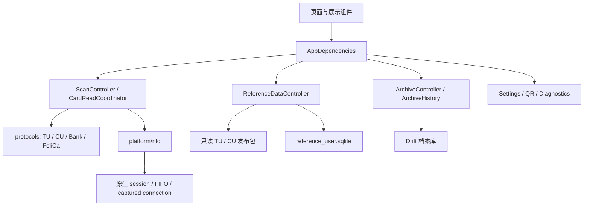

# TrafArch 架构与代码所有权

## 2.x 内部界面预览

`lib/main_gallery.dart` 启动 `InternalPreviewApp`，默认使用现有界面；内部宿主通过 `BetaUiScope` 向设置页提供“启用新界面（beta）”开关。开关仅保留在当前进程，重启恢复关闭。离开任一界面会释放该界面的状态；内部构建关闭自动更新检查，正式入口行为不变。

新版前端从零构建于 `lib/gallery/`，不复用旧页面、旧主题或旧导航。`GalleryApp` → `GalleryController` / `GalleryQrController` → 合成 fixtures，页面消费展示状态与回调，不创建 `AppDependencies` 或访问真实档案、NFC、相机、相册与文件导出通道。现有界面继续使用原业务层，新版模拟数据不会写入或覆盖真实档案。

`assets/gallery/fixtures.json` 保存 Demo 2.4.0 的 52 个场景、合成卡片／二维码、固定演示时钟及 2026-10-30 知识库快照。专用快照与发布参考数据库分离，由 `dev/gallery/extract_demo.cjs` 离线提取，保留来源哈希，不修改 SQLite 资产或 manifest。相册使用内置样例，导出显示预览；设置和模拟操作只存在于内存。将来由正式装配层提供展示模型与动作适配器接入业务。

Android Gradle 根据 Dart target 的文件名识别内部构建，仅该入口排除 Google Services 插件与 Firebase Analytics 依赖；包名、显示名称、原签名和每次打包预留下一构建号的流程保持统一。详见 [GALLERY.md](GALLERY.md)。

## JSON 档案与文件交换

`CardArchiveDocument` v1 是按卡片保存的完整 JSON 表示；数据库 v7 的 `archive_documents` 保存文档，原摘要、批次和观察时间表继续承担索引及事务写入。升级在同一事务内补齐旧档案，保留读取快照 v1/v2/v3 原文；文档格式版本、SQLite schema 与解析版本分别演进。旧调用方直接写索引时由触发器标记文档过期，仓库读取前事务刷新，保留导入行和未知扩展。

UI → `AppDependencies.archiveTransfer` → `ArchiveTransferController` → `CardRepository` / `ArchiveDocumentStore`（平台）负责导入导出。文件通道 `transit_card_analyzer/archive_documents` 的 `openJson` / `saveJson` 调用 Android SAF，读取和写入严格 UTF-8，32 MiB 上限；取消返回 null，错误不报告成功。应用关闭等待已开始的操作，选择器迟到结果不能启动导入。

完整备份以 `trafarch.archive` 封装完整卡片文档；字段导出使用独立 `trafarch.records` 平铺投影，不调用快照原文的 encode 来裁剪。TU/CU 各用冻结数据生成记录，只有已保存的确定关联才合并。字段文件导入在独立身份命名空间保存，不推断 NFC 身份、币种或缺失的字段。格式、字段和示例见 [JSON_ARCHIVE_FORMAT.md](JSON_ARCHIVE_FORMAT.md)。

合并时被替换的原始摘要保存在 `retainedSummaries`，按稳定身份进入历史与字段导出投影，来源为 `imported_summary`；不写成 NFC 读取批次，也不作为余额来源的批次证明。摘要字段与其观察时间一起选取，完整导入显式写入 null 并同步观察时间索引，避免刷新复活旧币种或旧时钟。

卡片列表与详情的 `ArchiveRecordCount` 复用 `projectArchiveRecords` 的去重记录行计数，不修改 `SavedCard.transactionCount`（最近一次交易文件观察数量）。计数包含 TU、CU、字段导入及保留摘要；上海 CU 镜像保留独立来源行，不等于票卡数量。旧数字摘要无明细时明确回退“最近读取交易”。`watchArchiveCardSummaries` 使用仓库单个 joined 订阅监听卡片与批次，在事务中批量读取文档与索引；clean 文档为权威，dirty 文档采用当前索引并保留 JSON 独有字段。每卡文档或输入投影错误只令该卡记录数待核实。列表 state 保存流，重建不重复订阅。

日期：2026-10-21。批准设计见 `superpowers/specs/2026-10-20-project-refactor-design.md`，实施基线 `8a4818e7d4dc848432a3e39a69195255138a3b95`。本文件描述当前源码；更早的审计 / 合并报告是带日期的历史证据。

## 目录

`features/trips/journey_presentation.dart` 负责纯展示投影，live 与 archive adapter 分别提供当前与捕获时的证据。只有同应用、币种、时钟、方式和共同读取批次内的明确进出事件才可配对，两端分别需要有效受理城市，允许城市不同；依据为唯一同一 1A、相邻连续交易序号或可靠连续 1E 原始槽位。公交还要求相同非空线路。跨城 `isCrossCity` 从有效两端城市派生，标题省略单一城市前缀；同城异地卡不省略城市。相邻序号及槽位配对不能跳过未知或中间记录，明确同一应用记录的双侧沿用自身关系。不能使用过滤后的列表序号代替原始槽位。各侧 payload 保留独立详情；票卡数量不替代交易笔数，UI 筛选不重新配对。

`trip_journey_evidence.dart` 和归档 adapter 仅在已保存关联的时间、城市、方式、角色、金额与唯一性均通过时，把原始 1E 槽位传给交易代表事件；POS 包含关系本身不建立行程。交易序号与物理槽位是独立证据，两个已知交易的序号缺口不能被槽位覆盖。1A/1E 同侧另需有效且严格相等的完整终端号；公交上车不使用标注金额作为扣款。模型在配对前折叠不同来源家族的已验证同侧操作，保留每个原始 `JourneyEvent`，详情和来源筛选仍可访问全部 payload。归档关联逐批次证明，不能经合并历史借用另一批次的身份。

轨道 `0x07`／`0x08` 与明确的补票状态映射到独立 `fareAdjustment`，不转换为普通进站。补票与出站仅走相邻连续证据路径，不走 1A 普通进出站关系；同钱包共同批次内，前一出站之后若已有未闭合进站或另一补票，则不能选取当前补票替代起点。可靠的连续交易序号也不能覆盖已知槽位冲突。补票配对保留各侧原始事件，`start` 仅表示补票地点与时间，`startsWithFareAdjustment` 控制补票站名右上角的小字标签；孤立补票根据事件角色复用同一站名组件，`duration` 留空。补票金额由 `fareAdjustmentAmountText` 独立传给卡片，`amountText` 仍是出站金额。行程后余额只沿用已确认的出站余额，补票不参与普通进站或公交的局部余额闭合。仅此展示投影变化不升级捕获解析版本、不改写快照或 JSON。

TU 0x18 与 1E/1A 的展示关联按来源分别执行两轮：先在全部事件间分配秒级时间对应，再对未使用的双方按有效 POS 包含关系补缺；同强度候选保持原顺序。重复使用同一终端时，POS 不能抢占其他事件的精确时间对应。该展示策略从解析口径 v11 起保存，余额仍使用独立的严格时间、金额、方向与双向唯一验证，旧快照不重新关联。

TU 1E 金额与记录余额默认按大端解析。v12 起，`TUnionProcessParser` 仅对同时满足 EP 进出站类型 `03/04`、轨道应用分类 `01`、受理城市 `2210`、终端前缀 `22104131`、收单机构 `1217221000000000` 的已核实沈阳格式采用小端；判断逐条使用受理方原始证据，与发卡地区无关，不以金额大小切换。该格式与同卡的大端 EC 轨道、EP 公交可以共存。原始 HEX、站点字段及币种不变，金额与余额解析值统一进入实时分析、新批次、历史投影与字段 JSON；旧档案继续消费捕获字段，不调用新解析器重写。记录余额的字节序修正不证明它是交易后余额，行程余额仍须通过下述独立局部证据核验。

行程余额投影的 `walletDeltaFen` 仅由明确的 0x18 消费或充值提供，且要求该笔余额已由钱包连续账本确认；归档还须全部来源版本不低于 v8 并显式保存 `balanceAfterIsRecorded=false`，旧展示兼容值不能成为新的独立佐证。对进出原始余额相同的完整行程，允许通过同批次唯一相邻的下一笔 1E 消费局部闭合：该消费须精确继承 0x18 关联和物理槽，原始记录余额等于已确认扣后余额，金额及有符号变化一致；区间内只准同钱包、同批次、同时钟的明确充值，每笔充值后的确认余额必须与累加结果一致。未知时间、同刻事件、缺槽、重复、未知操作或金额冲突均拒绝，不把充值前的候选余额用于延伸整条 1E 账本。单次公交 05/06 可通过与进出站相同的精确唯一验证继承原始槽位，不因此获得 1A 身份或参与进出站配对。此为展示投影增强，解析版本保持 v12，原始快照、HEX 和字段 JSON 的记录余额不改写。

`reference_data/domain/tu_cycle_station_resolver.dart` 统一当前展示、交易分析与新快照捕获的 TU 轨道查询。原始最长前缀结果若只有线路而无站名，仅可使用既有严格片段匹配补全同一原始来源和前缀内的站点；输入还须逐字符符合原线路字节与原站点字节各自后补 `00` 的格式，不丢弃未知站码或非零低字节，不转换原码进制。完整匹配、歧义和查询错误保持优先，未知站点不填默认值。SQLite 和 manifest 不因此改写，补全结果保留线路前缀与站点原始键的证据。历史档案仍按捕获值展示。

北京 TU `appTypeCode=00` 另有只用于地点查询的来源例外：城市必须为 `1000`，合法 16 位 HEX 终端须以 `0000` 开头，且 TripReader `m750d` 的原终端前缀分类明确为轨道。仅查询原始 `city + pos` 来源键，不启用片段兜底；例如终端分类键 `1000300` 与地点键 `1000040041` 使真实 `040041002C0000` 记录显示“4号线 / 角门西”。分类码、资金类型和原始记录不变，关联交易不因该地点赋予轨道 `stationType`，独立事件仍是 `other/unknown`，不将 `type06` 解释为退资。解析口径 v10 捕获新地点；归档普通卡和行程适配均消费 `capturedDisplay`，旧档案不重新查询参考库。

独立 1A 按两侧各自的城市、线路、站点和时间保存 `capturedDisplay`；独立 1E 保存本条记录的显示结果。归档消费捕获值，不用当前参考库重算。交易的 `resolvedBusLineLabel` 只来自公交解码／匹配结果，随 `capturedDisplay.line` 保存；票卡只为这种已解码数字线路添加“路”，原始线路码及前导零保持原样。历史身份比较忽略新增的 `capturedDisplay` 显示元数据，原字段与全部来源批次仍完整保留；其他未知原字段继续参与精确比较。

完成行程的金额和席别取出站事件，行程后余额优先采用已确认的出站交易后余额；v8+ 捕获仍须显式 `balanceAfterIsRecorded: false`。独立 1E 另以 `JourneyProcessBalanceEvidence` 传递原始金额、余额和自身来源槽位，在共享投影内逐行程验证：明确配对且同批次唯一可靠连续槽，进站金额为零，进出记录余额之差等于出站扣款时采用出站余额；两端余额相等时，还须更晚相邻 1E 的零金额进站余额等于原余额减扣款，并拒绝两个证据区间内的其他操作。同批次未知时间事件也阻断。只适用于已确认人民币直接钱包；1A 原始余额、未知解释、跨批次及冲突不提供证据。同侧折叠前按余额原事件的来源与槽位过滤，防止合并来源借证。不能沿 1E 全链倒推，因充值可能不写入 1E；单侧记录不凭原始余额直接生成行程后余额，单次公交仅适用下述独立局部闭合规则；进行中记录始终隐藏行程后余额。实时和档案共享此展示规则，旧档案有足够来源证明时可重新投影；不改写原始字段、快照 JSON、导出语义、数据库结构或捕获解析版本。仅有进站事件时隐藏金额、行程后余额与席别。用户确认的大兴机场线人民币 5000 分消费规则通过 `journeySeatLabel` 同时用于 live/archive；深圳 11 号线仍无启用规则。合并历史的显示字段和上下文均取最新捕获，各来源保留自己的参考包版本。

上海专用分析在缺少 1E/1A 注解时可匹配 CU 2000 终端资料，显示仍使用 TU 2900，账本和钱包保持 TU 来源。方向推断来源 `shanghai-cu-ledger-inference` 随 v9 解析结果保存，详情明确显示；旧余额版本阈值不变。上海镜像记录仅在展示层折叠，归档需所有来源批次均提供严格匹配的 TU 记录；原快照、CU 来源和导出不变。

独立单次公交须由同钱包、同批次的前后相邻物理槽形成局部余额闭合：前一完整行程的零金额进站余额减该行程扣款，必须等于其出站记录余额；该出站余额再减单次公交扣款，必须等于后一零金额进站的记录余额。单次记录原值须等于本次扣前或扣后值。仅有后一条锚不足以核实余额，因为充值可能不写入 1E。全部槽位须唯一可靠，所有区间均拒绝已知中间操作及同批次未知时间事件；受理城市可以不同，已确认数值冲突、未知币种及缺槽继续阻断。该结果仅为保存记录的局部闭合投影，不声称补齐卡片未保存的资金事件。原始记录余额保留，配对详情另外标注出站后余额。

旧档案仅在同批次物理帧足以证明目标 TU AID 的 SELECT 与成功 `00 B2 slot F4 Le` 响应时，派生可靠 1E 槽位来源。响应需与记录原始 HEX 唯一一致；仅有旧 `tu_process_record` 的自动编号或 `cycle[]` 下标不足以证明槽位。会话、帧顺序、应用选择、重复槽位／响应及明确不可靠标志都参与拒绝判定。该来源用于历史投影，快照、原始 HEX、捕获版本及 JSON 导出原文不被升级或改写。

```text
lib/
  main.dart
  app/                          根组件、依赖装配、主题、导航、版本
  protocols/
    iso7816/                    APDU 模型、交换策略、有界 BER-TLV
    transport/                  平台无关的传输失败
    transit/{tunion,city_union,local,qr}/
    bank/                       EMV / PBOC 枚举、读取、字典接口与领域模型
    felica/                     帧、协议、探测、卡适配器
  platform/{nfc,qr,storage,browser}/ MethodChannel、目录、设置、导出、日志、反馈浏览器
  features/
    scan/{application,domain}/  会话、采集、协议编排、当前读取展示
    reference_data/             发布包、用户库、查询接口、覆盖范围页面
    archive/                    档案模型、Drift、快照、统一历史查询、详情
    settings/                   设置与诊断控制器及页面
    qr/                         独立扫码页、相机 / 相册获取、字段 / 证书 / 原始数据展示
    transit_analysis/           识别、交易解码、行程分析
    home/                       各卡族独立面板
    expert/                     各文件和原始数据面板
    trips/                      行程条目、筛选、格式化与详情
    cards/                      档案列表
    bank_card/presentation/     银行卡界面
  shared/                       生命周期基类和少量展示常量
android/app/src/main/kotlin/com/kajolno/TrafArch/
  MainActivity.kt
  browser/                      指定 Edge / Chrome 的 Custom Tabs
  nfc/                          会话、连接、FIFO 调度、元数据
  platform/                     OnceResult
  qr/                           图片选择
  storage/                      下载目录导出
```

本轮按迁移映射移动 159 个文件，移除旧 `lib/core` / `lib/state` / `lib/database` 中的产品实现；没有建立旧路径转发文件链。现有测试源码的 import 随文件更新，回放传输器只留在 `test/support`。精确映射见 `REFACTOR_FILE_MAP_20261021.json`。

## 依赖与装配

`AppDependencies` 是根装配与展示门面，组合 Scan、ReferenceData、Archive、Settings、QR、Diagnostics 控制器。可变状态、异步工作和资源由各控制器负责。协议代码只依赖 Dart、协议领域模型和注入的传输函数，不反向引用 app、features、Flutter 平台通道或 SQLite。



目录层次不等同于强制编译模块；边界由源码依赖清单和静态检查约束。协议有意保留本地卡特例，没有用同一组默认值抹平不同卡族行为。

反馈问卷经 `FeedbackPage → AppDependencies → SettingsController → FeedbackBrowser` 调用独立的 `transit_card_analyzer/browser` 通道。原生逐个检测并启动 Edge、Chrome，启动 Intent 显式指定包名；失败回传页面，不隐式打开默认浏览器。QQ 加群页仍使用 `SurveyPage`。

## 采集和取消

ScanController 在发现标签前分配 UUID，并把它传到 ISO-DEP / NFC-F 通道。每个异步完成重新核对当前代次；旧结果不能更新新读取。物理指令和响应在采集边界保存不可变副本，后续 APDU 拼接不替代原始帧。原生返回的非空 sessionId 必须匹配。

Android 主线程拥有 session 和回复集合，普通 I/O 走共享单线程队列。取消先从 active 脱离，关闭工作捕获旧 session 的句柄；abort 与最终 sweep 形成 retirement barrier，后续连接等它完成。释放超时和引擎销毁返回明确失败，不冒充物理连接已释放。旧 MethodChannel 名称和旧参数形式保留。

## 协议机制

TU 1E 的 mode 05 成功响应可能只是文件前缀。平铺 48 字节响应按原始字节长度计算下一 P1，空槽占位不压缩；后续用 mode 04 逐槽补读，遇状态字拒绝、空响应、首条回卷或 P1 物理上限结束，不设城市或 30 条的人工截断。模板批量的兼容编号不证明物理槽，从 P1=1 逐条核实，每个完整且严格解包为 48 字节的响应只替换一个相同批量项，未核实项保持编号不可靠。异常长度响应保留原文但不解释为单槽行程。补读通信失败向上传递，已拆批量与成功补读前缀仍由 `read()` 的 `finally` 发布；无法切分的原始批量也保留。新读取可能增加少量末尾探测；旧档案缺少的过程记录需重新贴卡才有机会补齐。

共享 APDU engine 保留各族自己的 6100 / 6C00 / 6700、GET RESPONSE CLA、Le 修正顺序和资源上限。有效最终命令决定长度校验；Case 3 不把数据尾字节当 Le。共享 BER-TLV 树保留原始值、偏移与错误，深度 / 节点 / 字节有界。

传输失败是 `TransportFailure`；只在平台层把准确的原生异常类映射为卡片离场，通用 TRANSCEIVE_FAILED 保持未知。银行卡保留应用发现证据和每个应用读取结果，终止性通信失败后停止物理 I/O。FeliCa 保留已读取数据、服务访问结果和终止失败；不发明未公开服务。

上海双应用组合结果保留 TU、CU 各自的失败类型和已读内容；终止性错误阻断后续应用探测，APDU 状态字拒绝不等同于传输中断。主身份由已确认的 TU 身份决定，两侧余额的完整性分别表达。

CU 读取按配置区分消费（18）、充值（10）和异地通道（上海 2000/2153 为 06，其余为 1A），原始 SFI、槽位、交易序号、终端 HEX 随记录保留。`cu_transaction_analysis.dart` 为 CU 建立独立显示投影，匹配只使用已核实的受理地区、运营分类和原始交易时间，未知值不以发卡城市或 TU 规则代填。

## 参考数据和档案

发布包在构建时完成来源合并，运行时校验 manifest、大小、SHA256、元数据和必需列，并按内容哈希文件名安装、以只读模式打开。TU / CU 分别加载，任一失败不会阻断另一包。TU 与 CU 的城市命名空间独立，CU 受约束规则必须有对应上下文。歧义、未知、不可用分别表达。

档案有自己的数据库与生命周期。采集时上下文、余额观察、原始帧、解析版本、参考包版本和逐记录来源一起存入快照；展示层的记录抑制不决定归档。`ArchiveHistory` 同时服务详情与导出，不读取当前贴卡对象来补旧档案。时间 / 币种未知显式保留，详见 `MIGRATION.md`。

CU 在 v3 快照扩展 `cuProjection` 中保存独立记录与捕获时的匹配结果（内部版本 1），原始文件仍同时存入 `rawEvidence`。历史详情与导出恢复冻结结果，不按当前参考库重新解释旧数据；不支持或损坏的扩展保留原始快照并给出诊断，不改变 Drift 表结构。

## CDN 更新契约

`features/updates` 的 `UpdateService` 由 AppDependencies 装配，`UpdatePrompt` 在首帧后检查一次；`--dart-define=UPDATE_MANIFEST_URL=https://cdn.example.com/manifest.json` 未配置则完全不请求。当前 build 使用打包前从 pubspec 同步的 AppInfo，测试可注入 build 与获取函数。Debug / Profile / Release 打包成功后，pubspec 自动预留下一个构建号，AppInfo 保留产物实际使用的构建号；repairBuild 同样自增，普通测试、静态检查和 dry-run 不自增。整数 build 严格大于当前值才提示，version 仅展示；下载经 url_launcher 外部浏览器，不安装、不自动下载参考库。

manifest v1 必须含 `format_version: 1` 和 `app: {build: 整数, version: 字符串, notes: 字符串, download_url: HTTPS}`。可选 `references` 对象以 `TU` / `CU` 为键，每项为 `{url: HTTPS, package: {...}}`；package 原样复制离线 CLI 发布的 reference_manifest.json 对应包条目（file、sha256、bytes、content_version、tables）。HTTPS 禁止凭据、片段和所有重定向；连接超时 10 秒，总下载超时 30 秒，manifest 上限 256 KiB，单库上限 128 MiB。只请求 CDN 公共内容，无用户数据上传；CDN 仍能看到通常的网络连接信息。SHA256 校验完整性，不替代 CDN 发布端的可信性管理。

显式调用 `references.installUpdate('TU' 或 'CU', manifest.references[protocol]!)` 才下载并安装单库，可注入 fetch。复用 ReferencePackage 完整校验，并检查 KnowledgeBase.load 的 loadIssues 后才激活。并发安装拒绝；成功包和每协议独立的 JSON 激活记录存入应用支持目录 trafarch_reference_updates，临时激活记录写完后 rename 替换。启动独立验证激活包，坏包回退内置；失败不切换当前 KnowledgeBase。旧 KnowledgeBase 保留至控制器 dispose，避免 ScanPresentation 引用失效；代价是会话内多次更新占用额外句柄和空间，目前不自动清理历史哈希包。reference_user.sqlite 与档案库不属于此更新接口。

## 所有权与失败

参考控制器负责关闭 TU、CU 和用户库；初始化结束时若已销毁则立即释放返回资源。AppDependencies 关闭自建档案库前等待已接受的保存，外部注入库由调用者拥有。Notifier 销毁后丢弃通知。设置写入串行排队，读取旧文件失败会传播，完整临时文件写好后才替换正式文件。
