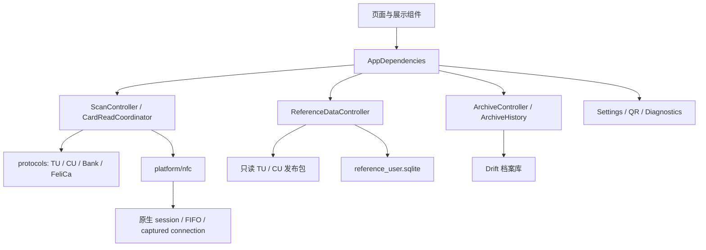

# TrafArch 架构与代码所有权

## 2.x 内部界面预览

`lib/main_gallery.dart` 启动 `InternalPreviewApp`，默认使用现有界面；内部宿主通过 `BetaUiScope` 向设置页提供“启用新界面（beta）”开关。开关仅保留在当前进程，重启恢复关闭。离开任一界面会释放该界面的状态；内部构建关闭自动更新检查，正式入口行为不变。

新版前端从零构建于 `lib/gallery/`，不复用旧页面、旧主题或旧导航。`GalleryApp` → `GalleryController` / `GalleryQrController` → 合成 fixtures，页面消费展示状态与回调，不创建 `AppDependencies` 或访问真实档案、NFC、相机、相册与文件导出通道。现有界面继续使用原业务层，新版模拟数据不会写入或覆盖真实档案。

Gallery 的关于、问题反馈、致谢与开源许可为独立页面，仍使用 Gallery 主题和导航；许可按需读取 Flutter `LicenseRegistry`。公开联系地址集中在 `shared/app_support.dart`，现有设置页复用。`InternalPreviewApp` 仅注入用户点击时打开公开网页／邮件应用的回调：网页使用既有 `FeedbackBrowser`，邮箱使用 `url_launcher`。不自动访问外链，也不传递卡片、日志或档案数据。底栏共享一个 180ms 水平滑动胶囊，主页面按底栏顺序以 240ms 左右滑动，跨项直达目标。子页面、二维码获取视图与弹层由稳定标识的只读导航栈驱动真实 Navigator 路由，退出内容保留自身展示上下文并停止交互；专家页列表和横向页签使用稳定滚动标识。

Gallery 运行时样式由 GalleryPalette／GalleryTokens、GalleryTypography 和 GalleryCardFace 集中定义，不再消费冻结 fixtures 的旧配色；其资源和业务样例保持独立。真实莫奈仅通过 dynamic_color 1.9.x 的系统颜色通道读取，在前台恢复时刷新；主题逐色插值，首页 SVG 标志映射有效主题色，不接入业务数据库或 NFC。设计依据为根 design.md，长期偏好见 docs/DESIGN_MEMORY.md。

主页面转场协调器只响应底栏点击，保留横向进入／退出、跨项直达与中途反向；正文横滑不再触发功能页切换。页面按稳定 key 构建并沿用 PageStorage，底栏胶囊保留平滑移动，专家内部标签只点击选择，其横向滚动独立消费手势。底栏、列表留白与提示条共用 GalleryNavigationLayout，从根 viewPadding／viewInsets 计算系统导航避让，键盘高度仍由 Scaffold 单独处理；两种底栏按钮行均在系统安全区之上。

可见底栏目的地由 `GalleryController.visibleMainPages` 明确列出首页、行程、专家、卡包四项，不依赖枚举数量计算。足迹前端、主页面分类和冻结场景保留供内部预览，用户场景列表通过 `visibleScenes` 隐藏足迹，不提供设置开关。下沉选中指示器固定使用当前主题色，仅对 alpha 动画，避免透明黑颜色插值造成灰黑中间帧。

`assets/gallery/fixtures.json` 保存 Demo 2.4.0 的 52 个场景、合成卡片／二维码、固定演示时钟及 2026-10-30 知识库快照。专用快照与发布参考数据库分离，由 `dev/gallery/extract_demo.cjs` 离线提取，保留来源哈希，不修改 SQLite 资产或 manifest。相册使用内置样例，导出显示预览；模拟操作和样例设置只存在于内存；“预测性返回手势”是独立的持久化界面偏好，不随恢复样例重置。将来由正式装配层提供展示模型与动作适配器接入业务。

Gallery 预测性返回使用 Flutter 公开的手势生命周期与自定义 PageRoute／PopupRoute：子页面水平跟手，抽屉向下跟手，取消恢复当前路由，提交从当前进度完成并仅返回一次。手势取消不取消二维码获取，真正返回时才取消；获取在手势中完成或场景重置时使旧手势失效。系统减少动画、关闭选项或不支持时保留普通返回，根主页面退出仍由系统处理。

`InternalPreviewApp` 通过既有 `SettingsStore` 注入 `GalleryPreferences` 的读写回调，新增 `gallery_predictive_back_enabled` 文本键（默认开启），不创建数据库。偏好跨新版会话及应用重启保留，读写失败在设置中显示重试入口，串行保存及修订标识防止迟到结果覆盖新选择。Gallery 不直接访问文件；其余新版样例状态仍不持久化。底栏文字、图标使用统一显式颜色动画与固定字重，无投影或触摸状态描边，键盘焦点单独绘制。

Gallery 周统计在独立展示模型中按固定演示周汇总，使用样例的明确币种及最小货币单位；只统计有明确日期的对应币种扣款。人民币／港币保留两位小数，日元使用整数；未知币种保留不可用，不从真实卡号、地区或当前时间推断。

卡包列表与共用大卡面通过纯展示帮助模型 `GalleryBalancePresentation` 分离币种与数字，输入现有余额文本和明确币种代码，统一显示 CNY ¥、JPY ¥、HKD $、USD $、MOP ¥。裸 ¥／$ 不补猜币种；原余额字段、交易明细、导出与周统计接口不受展示格式影响。

Android Gradle 根据 Dart target 的文件名识别内部构建，仅该入口排除 Google Services 插件与 Firebase Analytics 依赖；包名、显示名称、原签名和每次打包预留下一构建号的流程保持统一。详见 [GALLERY.md](GALLERY.md)。

Android 版本码直接使用 pubspec 的构建号，`force-version-code-ignoring-abi=true` 固定关闭 Flutter 拆分 APK 的 ABI 偏移；Gradle 拒绝用 false 覆盖，避免 AppInfo、更新比较与安装版本码再次分离。旧 arm64 产物源码构建号 2158 对应 Android versionCode 4158；当前 AppInfo 修正为上一产物号 4158，pubspec 将下一号统一到 4159，主版本名不变。打包前同步 AppInfo、成功打包后预留下一号的机制继续沿用；测试和配置检查不消耗号码。可通过 `dev/gallery/verify_version_codes.gradle` 只读核对 Debug／Profile／Release 各输出的配置版本码，最终交付仍须以 APK 清单为准。

## 小窗与分屏布局

Android 主 Activity 显式声明 `resizeableActivity=true`，沿用 Flutter embedding 处理窗口尺寸、方向与密度配置变化。界面按当前 Flutter 窗口约束布局，不锁定设备方向。卡片 JSON 导出和日志管理器使用可滚动的 AlertDialog，将标题、说明及选项放在同一滚动区域，操作按钮留在底部；导出模式根据窗口可用宽度和字体缩放改为纵向排列。悬浮导航在可用宽度不足以容纳四项及选中文字时改用等宽图标，保留选中态和语义标签，宽度恢复后显示文字。窗口调整不重建应用依赖，也不清空当前页签和弹窗选择。自动化窗口回归不替代厂商真机的标题栏、相机资源争用与 NFC 焦点切换验收。

## 内存预警与现场恢复

`TrafArchApplication` 持有 `HonorMemoryCoordinator`，通过 Application context 动态注册荣耀 `itgsa.intent.action.TRIM`／`KILL`；Android 13+ 使用 `RECEIVER_EXPORTED`，不绑定 Activity 生命周期。每条通知以类型、ID 和 Binder 隔离，接收器工作线程在 2.4 秒内完成一次回报；Flutter 未就绪、超时或写入失败回报失败。Binder 使用 `FIRST_CALL_TRANSACTION`、oneway，参数依次为 notifyType／notifyId／result／Bundle，不读取 one-way 回复。此公开广播协议未提供可验证的发送方权限；严格校验载荷，收到 KILL 只本地保存和中止读卡，不主动退出、不上传数据。

独立通道 `transit_card_analyzer/memory` 的原生→Dart `onMemoryPressure({'kill': bool, 'expiresAtMillis': int})` 返回 bool；原生 UI 队列与 Dart 消息队列均拒绝已过期通知。Dart→原生 `readRecovery`／`writeRecovery({'content': String})`／`clearRecovery` 只操作 `noBackupFilesDir/memory_recovery.json`。Android `AtomicFile` 发布完整文件，限制 UTF-8 8 MiB，不进入系统备份；有效期 24 小时，读取成功后消费，损坏／过期文件清理，新读取和确认操作作废旧现场。没有新增 SQLite 文件、表、迁移或后台服务。

`AppDependencies` 将 TRIM 与 `WidgetsBindingObserver.didHaveMemoryPressure` 统一为可重建缓存清理；不销毁借给当前展示的参考库连接，不删除原始帧／日志／未保存结果。KILL 同步失效当前读卡代次，发起但不等待物理 NFC 关闭；现场写入、诊断及已接受档案操作使用独立 1.8 秒等待预算，超时如实返回失败。恢复启动就绪前不自动扫描。恢复主 Tab、设置／二维码／档案详情入口及行程筛选；临时弹窗返回父页面，不恢复相机或 NFC 句柄。交通卡沿用捕获快照的历史展示器，银行卡／FeliCa 保留已读字段与物理证据，不重跑协议、匹配或自动归档。恢复文件保留快照原文；待保存内容由恢复面板显式确认，沿用原读取时间和捕获解析版本，新档案继续执行既有保存观察元数据策略。

## JSON 档案与文件交换

`CardArchiveDocument` v1 是按卡片保存的完整 JSON 表示；数据库 v7 的 `archive_documents` 保存文档，原摘要、批次和观察时间表继续承担索引及事务写入。升级在同一事务内补齐旧档案，保留读取快照 v1/v2/v3 原文；文档格式版本、SQLite schema 与解析版本分别演进。旧调用方直接写索引时由触发器标记文档过期，仓库读取前事务刷新，保留导入行和未知扩展。

UI → `AppDependencies.archiveTransfer` → `ArchiveTransferController` → `CardRepository` / `ArchiveDocumentStore`（平台）负责导入导出。文件通道 `transit_card_analyzer/archive_documents` 的 `openJson` / `saveJson` 调用 Android SAF，读取和写入严格 UTF-8，32 MiB 上限；取消返回 null，错误不报告成功。应用关闭等待已开始的操作，选择器迟到结果不能启动导入。

完整备份以 `trafarch.archive` 封装完整卡片文档；字段导出使用独立 `trafarch.records` 平铺投影，不调用快照原文的 encode 来裁剪。TU/CU 各用冻结数据生成记录，只有已保存的确定关联才合并。字段文件导入在独立身份命名空间保存，不推断 NFC 身份、币种或缺失的字段。格式、字段和示例见 [JSON_ARCHIVE_FORMAT.md](JSON_ARCHIVE_FORMAT.md)。

合并时被替换的原始摘要保存在 `retainedSummaries`，按稳定身份进入历史与字段导出投影，来源为 `imported_summary`；不写成 NFC 读取批次，也不作为余额来源的批次证明。摘要字段与其观察时间一起选取，完整导入显式写入 null 并同步观察时间索引，避免刷新复活旧币种或旧时钟。

卡片列表与详情的 `ArchiveRecordCount` 复用 `projectArchiveRecords` 的去重记录行计数，不修改 `SavedCard.transactionCount`（最近一次交易文件观察数量）。计数包含 TU、CU、字段导入及保留摘要；上海 CU 镜像保留独立来源行，不等于票卡数量。旧数字摘要无明细时明确回退“最近读取交易”。`watchArchiveCardSummaries` 使用仓库单个 joined 订阅监听卡片与批次，在事务中批量读取文档与索引；clean 文档为权威，dirty 文档采用当前索引并保留 JSON 独有字段。每卡文档或输入投影错误只令该卡记录数待核实。列表 state 保存流，重建不重复订阅。

日期：2026-10-21。批准设计见 `superpowers/specs/2026-10-20-project-refactor-design.md`，实施基线 `8a4818e7d4dc848432a3e39a69195255138a3b95`。本文件描述当前源码；更早的审计 / 合并报告是带日期的历史证据。

## 目录

`features/trips/journey_presentation.dart` 负责纯展示投影，live 与 archive adapter 分别提供当前与捕获时的证据。只有同应用、币种、时钟、方式和共同读取批次内的明确进出事件才可配对，两端分别需要有效受理城市，允许城市不同；依据为唯一同一 1A、相邻连续交易序号或可靠连续 1E 原始槽位。公交还要求相同非空线路。跨城 `isCrossCity` 从有效两端城市派生，标题省略单一城市前缀；同城异地卡不省略城市。相邻序号及槽位配对不能跳过未知或中间记录，明确同一应用记录的双侧沿用自身关系。不能使用过滤后的列表序号代替原始槽位。各侧 payload 保留独立详情；票卡数量不替代交易笔数，UI 筛选不重新配对。

`trip_journey_evidence.dart` 和归档 adapter 仅在已保存关联的时间、城市、方式、角色、金额与唯一性均通过时，把原始 1E 槽位传给交易代表事件；POS 包含关系本身不建立行程。交易序号与物理槽位是独立证据，两个已知交易的序号缺口不能被槽位覆盖。1A/1E 同侧另需有效且严格相等的完整终端号；公交上车不使用标注金额作为扣款。模型在配对前折叠不同来源家族的已验证同侧操作，保留每个原始 `JourneyEvent`，详情和来源筛选仍可访问全部 payload。归档关联逐批次证明，不能经合并历史借用另一批次的身份。

轨道 `0x07`／`0x08` 与明确的补票状态映射到独立 `fareAdjustment`，不转换为普通进站。补票与出站仅走相邻连续证据路径，不走 1A 普通进出站关系；同钱包共同批次内，前一出站之后若已有未闭合进站或另一补票，则不能选取当前补票替代起点。可靠的连续交易序号也不能覆盖已知槽位冲突。补票配对保留各侧原始事件，`start` 仅表示补票地点与时间，`startsWithFareAdjustment` 控制补票站名右上角的小字标签；孤立补票根据事件角色复用同一站名组件，`duration` 留空。补票金额由 `fareAdjustmentAmountText` 独立传给卡片，`amountText` 仍是出站金额。行程后余额只沿用已确认的出站余额，补票不参与普通进站或公交的局部余额闭合。仅此展示投影变化不升级捕获解析版本、不改写快照或 JSON。

TU 0x18 与 1E/1A 的展示关联按来源分别执行两轮：先在全部事件间分配秒级时间对应，再对未使用的双方按有效 POS 包含关系补缺；同强度候选保持原顺序。重复使用同一终端时，POS 不能抢占其他事件的精确时间对应。该展示策略从解析口径 v11 起保存，余额仍使用独立的严格时间、金额、方向与双向唯一验证，旧快照不重新关联。

TU 1E 金额与记录余额默认按大端解析。v12 起，`TUnionProcessParser` 仅对同时满足 EP 进出站类型 `03/04`、轨道应用分类 `01`、受理城市 `2210`、终端前缀 `22104131`、收单机构 `1217221000000000` 的已核实沈阳格式采用小端；判断逐条使用受理方原始证据，与发卡地区无关，不以金额大小切换。该格式与同卡的大端 EC 轨道、EP 公交可以共存。原始 HEX、站点字段及币种不变，金额与余额解析值统一进入实时分析、新批次、历史投影与字段 JSON；旧档案继续消费捕获字段，不调用新解析器重写。记录余额的字节序修正不证明它是交易后余额，行程余额仍须通过下述独立局部证据核验。

行程余额投影的 `walletDeltaFen` 仅由明确的 0x18 消费或充值提供，且要求该笔余额已由钱包连续账本确认；归档还须全部来源版本不低于 v8 并显式保存 `balanceAfterIsRecorded=false`，旧展示兼容值不能成为新的独立佐证。对进出原始余额相同的完整行程，允许通过同批次唯一相邻的下一笔 1E 消费局部闭合：该消费须精确继承 0x18 关联和物理槽，原始记录余额等于已确认扣后余额，金额及有符号变化一致；区间内只准同钱包、同批次、同时钟的明确充值，每笔充值后的确认余额必须与累加结果一致。未知时间、同刻事件、缺槽、重复、未知操作或金额冲突均拒绝，不把充值前的候选余额用于延伸整条 1E 账本。单次公交 05/06 可通过与进出站相同的精确唯一验证继承原始槽位，不因此获得 1A 身份或参与进出站配对。此为展示投影增强，解析版本保持 v12，原始快照、HEX 和字段 JSON 的记录余额不改写。

`reference_data/domain/tu_cycle_station_resolver.dart` 统一当前展示、交易分析与新快照捕获的 TU 轨道查询。原始最长前缀结果若只有线路而无站名，仅可使用既有严格片段匹配补全同一原始来源和前缀内的站点；输入还须逐字符符合原线路字节与原站点字节各自后补 `00` 的格式，不丢弃未知站码或非零低字节，不转换原码进制。完整匹配、歧义和查询错误保持优先，未知站点不填默认值。SQLite 和 manifest 不因此改写，补全结果保留线路前缀与站点原始键的证据。历史档案仍按捕获值展示。

北京 TU `appTypeCode=00` 另有只用于地点查询的来源例外：城市必须为 `1000`，合法 16 位 HEX 终端须以 `0000` 开头，且 TripReader `m750d` 的原终端前缀分类明确为轨道。仅查询原始 `city + pos` 来源键，不启用片段兜底；例如终端分类键 `1000300` 与地点键 `1000040041` 使真实 `040041002C0000` 记录显示“4号线 / 角门西”。分类码、资金类型和原始记录不变，关联交易不因该地点赋予轨道 `stationType`，独立事件仍是 `other/unknown`，不将 `type06` 解释为退资。解析口径 v10 捕获新地点；归档普通卡和行程适配均消费 `capturedDisplay`，旧档案不重新查询参考库。

独立 1A 按两侧各自的城市、线路、站点和时间保存 `capturedDisplay`；独立 1E 保存本条记录的显示结果。归档消费捕获值，不用当前参考库重算。交易的 `resolvedBusLineLabel` 只来自公交解码／匹配结果，随 `capturedDisplay.line` 保存；票卡只为这种已解码数字线路添加“路”，原始线路码及前导零保持原样。历史身份比较忽略新增的 `capturedDisplay` 显示元数据，原字段与全部来源批次仍完整保留；其他未知原字段继续参与精确比较。

完成行程的金额和席别取出站事件，行程后余额优先采用已确认的出站交易后余额；v8+ 捕获仍须显式 `balanceAfterIsRecorded: false`。独立 1E 另以 `JourneyProcessBalanceEvidence` 传递原始金额、余额和自身来源槽位，在共享投影内逐行程验证：明确配对且同批次唯一可靠连续槽，进站金额为零，进出记录余额之差等于出站扣款时采用出站余额；两端余额相等时，还须更晚相邻 1E 的零金额进站余额等于原余额减扣款，并拒绝两个证据区间内的其他操作。同批次未知时间事件也阻断。只适用于已确认人民币直接钱包；1A 原始余额、未知解释、跨批次及冲突不提供证据。同侧折叠前按余额原事件的来源与槽位过滤，防止合并来源借证。不能沿 1E 全链倒推，因充值可能不写入 1E；单侧记录不凭原始余额直接生成行程后余额，单次公交仅适用下述独立局部闭合规则；进行中记录始终隐藏行程后余额。实时和档案共享此展示规则，旧档案有足够来源证明时可重新投影；不改写原始字段、快照 JSON、导出语义、数据库结构或捕获解析版本。仅有进站事件时隐藏金额、行程后余额与席别。用户确认的大兴机场线人民币 5000 分消费规则通过 `journeySeatLabel` 同时用于 live/archive；深圳 11 号线仍无启用规则。合并历史的显示字段和上下文均取最新捕获，各来源保留自己的参考包版本。

上海专用分析在缺少 1E/1A 注解时可匹配 CU 2000 终端资料，显示仍使用 TU 2900，账本和钱包保持 TU 来源。方向推断来源 `shanghai-cu-ledger-inference` 随 v9 解析结果保存，详情明确显示；旧余额版本阈值不变。上海镜像记录仅在展示层折叠，归档需所有来源批次均提供严格匹配的 TU 记录；原快照、CU 来源和导出不变。

独立单次公交须由同钱包、同批次的前后相邻物理槽形成局部余额闭合：前一完整行程的零金额进站余额减该行程扣款，必须等于其出站记录余额；该出站余额再减单次公交扣款，必须等于后一零金额进站的记录余额。单次记录原值须等于本次扣前或扣后值。仅有后一条锚不足以核实余额，因为充值可能不写入 1E。全部槽位须唯一可靠，所有区间均拒绝已知中间操作及同批次未知时间事件；受理城市可以不同，已确认数值冲突、未知币种及缺槽继续阻断。该结果仅为保存记录的局部闭合投影，不声称补齐卡片未保存的资金事件。原始记录余额保留，配对详情另外标注出站后余额。

旧档案仅在同批次物理帧足以证明目标 TU AID 的 SELECT 与成功 `00 B2 slot F4 Le` 响应时，派生可靠 1E 槽位来源。响应需与记录原始 HEX 唯一一致；仅有旧 `tu_process_record` 的自动编号或 `cycle[]` 下标不足以证明槽位。会话、帧顺序、应用选择、重复槽位／响应及明确不可靠标志都参与拒绝判定。该来源用于历史投影，快照、原始 HEX、捕获版本及 JSON 导出原文不被升级或改写。

```text
lib/
  main.dart
  app/                          根组件、依赖装配、主题、导航、版本
  protocols/
    iso7816/                    APDU 模型、交换策略、有界 BER-TLV
    transport/                  平台无关的传输失败
    transit/{tunion,city_union,local,qr}/
    bank/                       EMV / PBOC 枚举、读取、字典接口与领域模型
    felica/                     帧、协议、探测、卡适配器
  platform/{nfc,qr,storage,browser}/ MethodChannel、目录、设置、导出、日志、反馈浏览器
  features/
    scan/{application,domain}/  会话、采集、协议编排、当前读取展示
    reference_data/             发布包、用户库、查询接口、覆盖范围页面
    archive/                    档案模型、Drift、快照、统一历史查询、详情
    settings/                   设置与诊断控制器及页面
    qr/                         独立扫码页、相机 / 相册获取、字段 / 证书 / 原始数据展示
    transit_analysis/           识别、交易解码、行程分析
    home/                       各卡族独立面板
    expert/                     各文件和原始数据面板
    trips/                      行程条目、筛选、格式化与详情
    cards/                      档案列表
    bank_card/presentation/     银行卡界面
  shared/                       生命周期基类和少量展示常量
android/app/src/main/kotlin/com/kajolno/TrafArch/
  MainActivity.kt
  browser/                      Custom Tabs 支持检测与默认浏览器回退
  nfc/                          会话、连接、FIFO 调度、元数据
  platform/                     OnceResult
  qr/                           图片选择
  storage/                      下载目录导出
```

本轮按迁移映射移动 159 个文件，移除旧 `lib/core` / `lib/state` / `lib/database` 中的产品实现；没有建立旧路径转发文件链。现有测试源码的 import 随文件更新，回放传输器只留在 `test/support`。精确映射见 `REFACTOR_FILE_MAP_20261021.json`。

## 依赖与装配

### 银行卡严格只读边界

EMV／PBOC 共享 `ContactlessReadParser`，银行卡解析版本为 0.3.0。读取仅选择应用、以 `80 CA 9F 36 Le` 直接取得 ATC，再用绝对记录号 READ RECORD 枚举 SFI 1..30 的公开记录。每文件从记录 1 开始，拒绝后停止该文件；成功与失败读取共用单应用 254 次预算，通信失败即停止。没有 GPO 提供的 AFL，因此无法保证记录完整性；受访问条件保护的字段保持缺失，结果为部分读取。

GPO 在部分非接触卡上会生成应用密文或递增 ATC，零金额与空 PDOL 均不能保证无副作用。当前流程移除 GPO 及 PDOL 组包，不提供交易模式或回退。`BankReadOnlyPolicy` 对 CLA、INS、参数和 APDU 结构实行封闭白名单，既用于 `exchangeReadOnly` 的初始及续传指令，也用于最接近实际通道的 `RecordingCardTransport`，禁止 GPO、GENERATE AC、PIN、认证、写入及未知指令。只允许 SELECT by name、绝对 READ RECORD、读取 9F36 的 GET DATA 和 GET RESPONSE，保留有界 61XX／6CXX 处理。`ParsedApplication.dataTags` 保留直接读取结果并进入界面、恢复捕获及诊断；旧 `gpoTags/gpoHex` 仅兼容已有捕获，不重读或改写历史数据。原生通道冻结契约不变。

### 边到边显示与系统安全区域

Android targetSdk 保持 37，遵守 Android 15 起强制边到边显示的要求，不设置退出项。`main.dart` 显式启用 `SystemUiMode.edgeToEdge`，Android 30+ 明暗两套 LaunchTheme／NormalTheme 均声明 `windowLayoutInDisplayCutoutMode=always`，启动窗口与 Flutter 内容一致允许延伸至刘海区域。

`MaterialApp.builder` 通过 `AnnotatedRegion<SystemUiOverlayStyle>` 根据实际主题背景设置导航栏图标亮度，AppBar／SliverAppBar 继续根据自身背景决定状态栏图标；黑色扫码页面单独声明浅色系统栏图标，退出后由当前页面恢复。透明系统栏颜色仅用于兼容较旧 Android，不依赖 Android 15 已停用的栏颜色 API 防遮挡；三按钮导航保留系统对比度保护，手势导航保持透明。

交互内容根据 `MediaQuery` 的当前窗口安全区域避让系统栏及刘海：AppBar／SliverAppBar 处理顶部，正文 SafeArea 处理侧边与底部，悬浮导航使用底栏库已有的 SafeArea，避免重复叠加。记录详情弹层除 `useSafeArea: true` 外，还在内容外补充底部 SafeArea（框架的该参数只保护顶部和侧边）；档案批次诊断及恢复原始数据页同样使用 FoldSafePage 与正文 SafeArea。回归覆盖手势／三按钮的底部边距、横屏侧边刘海、明暗主题切换、扫码进退及弹层最后操作可点击；真实 Android 15+ 设备的系统栏与启动画面仍需设备验收。

规范来源：https://developer.android.com/about/versions/15/behavior-changes-15#edge-to-edge

### 窗口与折叠屏布局

展示层 `shared/presentation/adaptive_layout.dart` 结合 ITGSA 大屏白皮书 2.2／4.2／4.4 和 Android 列表详情布局按当前窗口逻辑像素适配内容。手机、平板、横屏及分屏统一使用居中的悬浮胶囊底栏，沿用 280dp 宽度上限、56dp 高度、28dp 圆角与距系统安全区 20dp 的间距；窄窗及大字体沿用等宽图标收缩，滚动显隐与子页面返回回显保持一致。壳页不创建侧边导航及竖分隔线，状态栏背景保持连续；AppBar／SliverAppBar 独立处理顶部安全区，不额外增加一层顶部留白。主页面 IndexedStack 与底栏始终挂载在同一容器，窗口缩放不重建控制器或等待中的 NFC；主页面统一预留悬浮底栏留白，独立档案详情路由不预留主导航高度。首页在正文可用宽度至少 840 时左右排布，顺序列表及设置内容限宽。

专家页与二维码结果页共用 `ExpertField`，字段名后统一显示中文冒号，字段标签和值通过 Wrap 按实际文字及当前字体缩放宽度排布，不按窗口断点强制上下排列，也不为短标签预留固定宽列。能容纳的字段保持同行；长值移到下一行并获得完整正文宽度，允许自然换行，不截断公钥、HEX、账户或诊断原文。

`AdaptiveCardDetailPage` 在同一路由保存当前卡片 ID，`AdaptiveListDetail` 在可用宽度至少 840 且高度至少 480 时并列列表和详情；窄窗仅显示已选择详情，系统返回退出详情路由。列表与详情窗格通过稳定 key、Offstage 保持挂载，详情的查询流、筛选和滚动不因窗口缩放重新创建；各窗格独立 ScaffoldMessenger，避免同一 SnackBar 同时注册多个 Hero。已存在的本地恢复继续保存选中卡片路径与筛选，不写入新的数据库字段。

折叠屏只按折叠与展开后的当前窗口尺寸适配外屏／内屏，不识别半折、书本或桌面姿态，不根据折叠角度切换布局。`MaterialApp.builder` 在 Navigator 与 Overlay 外统一注入 `FoldableDisplayScope`，从布局使用的 `MediaQuery.displayFeatures` 中过滤 fold 折痕及零面积特征，完整页面与列表详情组件也应用同一规则；主页面、路由、Dialog 与 BottomSheet 均不因半折信号缩至半屏或重新分栏。实体铰链及刘海仍按真实遮挡区域避让，完整页面通过 DisplayFeatureSubScreen 更新可用子屏和局部 MediaQuery，列表详情仅可沿满足两侧最小宽度的实体竖向铰链分栏，其余按当前可用宽高布局。行程面板保留触发 anchorPoint 与 useSafeArea，对话框最大宽度 560。Android 17／targetSdk 37 不添加限制旋转／缩放的兼容退出项，不接入厂商平行视窗或 Activity Embedding 来拆分同一 Flutter 引擎。

扫码页拥有外部 MobileScannerController，因此自行监听 WidgetsBinding 生命周期，将相机 stop/start 串行化，处理权限请求尚未结束时进入 inactive 的情况，失败后允许用户重试；窗口布局变化不重建相机控制器。预览比例和旋转交给现有 CameraX／mobile_scanner，NFC 通道与会话契约保持不变。模拟回归不能证明厂商内外屏、相机独占资源、物理 NFC 连接或系统强杀行为，仍需真机验收。

2.x Gallery 使用独立 `GalleryWindow`，置于 MaterialApp.builder 的 Navigator／Overlay 外，复用 FoldableDisplayScope 过滤折痕。实体铰链分隔时选最大子屏，等面积优先左／上；通过 removeDisplayFeatures 调整 Insets 后显式更新 MediaQuery.size，背景保持全窗口主题色。标题和正文限宽 720dp，悬浮导航 320dp、下沉按钮区域 720dp，不引入双栏。布局缩放保持 GalleryController 和路由身份；展示层锚点注册表按布局、滚动和窗口指标变化重测，GalleryRouteEntry 的可选 anchorId 连接真实触发器，原 anchor 仅为无触发器样例提供回退。Flutter embedding 已合并 captionBar 到系统安全区，不新增原生桥接；Gallery 仍为隔离样例，不改变 NFC、相机或进程恢复政策。相关行为与尺寸回归见 gallery_window_layout_test。

规范来源：
- https://www.itgsa.com/documents/5242001394058240
- https://developer.android.com/develop/ui/compose/layouts/adaptive/list-detail
- https://developer.android.com/develop/ui/compose/layouts/adaptive/foldables/make-your-app-fold-aware
- https://developer.android.com/about/versions/17/changes/ff-restrictions-ignored

`AppDependencies` 是根装配与展示门面，组合 Scan、ReferenceData、Archive、Settings、QR、Diagnostics 控制器。可变状态、异步工作和资源由各控制器负责。协议代码只依赖 Dart、协议领域模型和注入的传输函数，不反向引用 app、features、Flutter 平台通道或 SQLite。



目录层次不等同于强制编译模块；边界由源码依赖清单和静态检查约束。协议有意保留本地卡特例，没有用同一组默认值抹平不同卡族行为。

反馈问卷和隐私政策经 `AppDependencies → SettingsController → FeedbackBrowser` 调用独立的 `transit_card_analyzer/browser` 通道。原生先通过 `CustomTabsClient.getPackageName(activity, null)` 检测已安装浏览器的 Custom Tabs 支持，不限制包名；有提供方则显式指定该包打开 Custom Tab，没有提供方或启动失败则用 `ACTION_VIEW` 交给默认浏览器直接打开原网址（未设置默认浏览器时由系统选择）。通道返回提供方包名或 `default_browser` 表示打开成功，仅两种方式均失败时返回 null，由 Dart 复制链接并提示。QQ 群入口经 `AppDependencies → SettingsController` 使用 `url_launcher` 的外部应用模式，优先以 `mqqapi://card/show_pslcard` 打开指定群资料页；启动失败时改用原 HTTPS 邀请页，两种方式均失败则提示用户复制群号搜索。

## 采集和取消

ScanController 在发现标签前分配 UUID，并把它传到 ISO-DEP / NFC-F 通道。每个异步完成重新核对当前代次；旧结果不能更新新读取。物理指令和响应在采集边界保存不可变副本，后续 APDU 拼接不替代原始帧。原生返回的非空 sessionId 必须匹配。

Android 主线程拥有 session 和回复集合，普通 I/O 走共享单线程队列。取消先从 active 脱离，关闭工作捕获旧 session 的句柄；abort 与最终 sweep 形成 retirement barrier，后续连接等它完成。释放超时和引擎销毁返回明确失败，不冒充物理连接已释放。旧 MethodChannel 名称和旧参数形式保留。

## 协议机制

TU 1E 的 mode 05 成功响应可能只是文件前缀。平铺 48 字节响应按原始字节长度计算下一 P1，空槽占位不压缩；后续用 mode 04 逐槽补读，遇状态字拒绝、空响应、首条回卷或 P1 物理上限结束，不设城市或 30 条的人工截断。模板批量的兼容编号不证明物理槽，从 P1=1 逐条核实，每个完整且严格解包为 48 字节的响应只替换一个相同批量项，未核实项保持编号不可靠。异常长度响应保留原文但不解释为单槽行程。补读通信失败向上传递，已拆批量与成功补读前缀仍由 `read()` 的 `finally` 发布；无法切分的原始批量也保留。新读取可能增加少量末尾探测；旧档案缺少的过程记录需重新贴卡才有机会补齐。

共享 APDU engine 保留各族自己的 6100 / 6C00 / 6700、GET RESPONSE CLA、Le 修正顺序和资源上限。有效最终命令决定长度校验；Case 3 不把数据尾字节当 Le。共享 BER-TLV 树保留原始值、偏移与错误，深度 / 节点 / 字节有界。

传输失败是 `TransportFailure`；只在平台层把准确的原生异常类映射为卡片离场，通用 TRANSCEIVE_FAILED 保持未知。银行卡保留应用发现证据和每个应用读取结果，终止性通信失败后停止物理 I/O。FeliCa 保留已读取数据、服务访问结果和终止失败；不发明未公开服务。

上海双应用组合结果保留 TU、CU 各自的失败类型和已读内容；终止性错误阻断后续应用探测，APDU 状态字拒绝不等同于传输中断。主身份由已确认的 TU 身份决定，两侧余额的完整性分别表达。

CU 读取按配置区分消费（18）、充值（10）和异地通道（上海 2000/2153 为 06，其余为 1A），原始 SFI、槽位、交易序号、终端 HEX 随记录保留。`cu_transaction_analysis.dart` 为 CU 建立独立显示投影，匹配只使用已核实的受理地区、运营分类和原始交易时间，未知值不以发卡城市或 TU 规则代填。

CU 的实时行程、档案详情与恢复现场通过 `cu_trip_presenter.dart` 适配共用的 `TripCardsView`、票据式 `TripEntryCard` 和详情弹层，来源按 CU 实际文件筛选，方式采用已解码的运营分类或唯一匹配类别；充值和未知方式放在其他记录。金额展示沿用 Trip Reader 1.7.17 的可追踪规则：金额字段字节 07-09 按卡内分解释，消费为负、充值为正；字节 06 仍包含在四字节原字段中，详情完整保留 `amountHex`、`amountRaw` 与解释依据，不从余额反推交易金额。CU 目前缺少已核实的进出站方向，事件保持 `unknown`，不因零金额、连续序号或终端分类组成完整行程；票卡显示交易金额，但行程后余额保持未知。详情保留线路站点编码、HEX、异常与全部保存来源。日期使用 CU 捕获的 UTC+08 卡内时钟，不随手机时区换日；实时 CU 补齐卡名、卡号、当前余额与可见记录数摘要。异地标识只比较 CU 命名空间内的发卡地区与受理地区，历史要求每份来源均能独立核实；上海双应用的镜像折叠继续保留。CU 筛选以独立恢复键保存，不改变快照、解析版本或数据库。

通用地方交通卡（武汉通 / 北京互通卡 / 深圳通本地 / 苏州苏薪·计次 / 天府通，parserId `localCard`）的行程同样经 `local_card_trip_presenter.dart` 适配到共享票据式行程卡：实时行程页、已保存卡片详情与恢复现场共用卡片、来源／方式筛选与详情弹层，行程来源按记录文件（地铁／公交／轮渡／通行流水／其他）映射，方式随地铁（轨道交通）与公交（公共汽电车）分类，其余归其他记录。金额沿卡内 `balanceDelta` 分字段展示（消费为负、充值为正），未知时间为空、未重建余额不展示（与 CU 一致，不把默认 0 当作真实余额）；终端 HEX、类型字节、状态字节、城市代码与原始字节进入详情。快照以 `localCardTrips` 扩展保存行程流水（版本 1），历史投影与文本导出经 `restoreLocalTripRecord` 还原后复用同一票据卡；通用地方卡由 `CardIdentificationService` 按解析器级系统标识 + 应用到卡号生成稳定指纹并建档（缺卡号不建档、不猜测城市），岭南通／澳门通／BMAC 继续各自专属面板。数据库与 manifest 不变，不改写已有快照。

## 参考数据和档案

发布包在构建时完成来源合并，运行时校验 manifest、大小、SHA256、元数据和必需列，并按内容哈希文件名安装、以只读模式打开。TU / CU 分别加载，任一失败不会阻断另一包。TU 与 CU 的城市命名空间独立，CU 受约束规则必须有对应上下文。歧义、未知、不可用分别表达。

档案有自己的数据库与生命周期。采集时上下文、余额观察、原始帧、解析版本、参考包版本和逐记录来源一起存入快照；展示层的记录抑制不决定归档。`ArchiveHistory` 同时服务详情与导出，不读取当前贴卡对象来补旧档案。时间 / 币种未知显式保留，详见 `MIGRATION.md`。

已保存行程通过 `ArchiveHistory.projectRecords` 从每个 `ArchiveBatchEvidence` 的原始快照独立投影，匹配时保留同批次的每个记录路径。`ArchiveTripProjection.journeys` 只合并已经在各自批次内完成验证的展示结果，`TripCardsView.projectedJourneys` 消费此结果后不再调用配对器。聚合记录与计数仍沿用精确历史身份，避免旧的可变 1A、展示关联或余额捕获干扰新批次的唯一性。跨批展示身份由完整交易／1E 原码及原始字段、钱包和时钟上下文构成；可变 1A 只按原码重新核实本侧字段，不借另一侧、站名或数组位置判断身份。每批余额仍使用其原捕获解释，跨批合并不重新推导金额或余额；重复候选和已知冲突不择新覆盖。全部来源及原始详情继续保留，JSON、数据库结构与解析版本不变。

CU 在 v3 快照扩展 `cuProjection` 中保存独立记录与捕获时的匹配结果（内部版本 1），原始文件仍同时存入 `rawEvidence`。历史详情与导出恢复冻结结果，不按当前参考库重新解释旧数据；不支持或损坏的扩展保留原始快照并给出诊断，不改变 Drift 表结构。

## CDN 更新契约

`features/updates` 的 `UpdateService` 由 AppDependencies 装配，`UpdatePrompt` 在首帧后检查一次；`--dart-define=UPDATE_MANIFEST_URL=https://cdn.example.com/manifest.json` 未配置则完全不请求。当前 build 使用打包前从 pubspec 同步的 AppInfo，测试可注入 build 与获取函数。Debug / Profile / Release 打包成功后，pubspec 自动预留下一个构建号，AppInfo 保留产物实际使用的构建号；repairBuild 同样自增，普通测试、静态检查和 dry-run 不自增。整数 build 严格大于当前值才提示，version 仅展示；下载经 url_launcher 外部浏览器，不安装、不自动下载参考库。

manifest v1 必须含 `format_version: 1` 和 `app: {build: 整数, version: 字符串, notes: 字符串, download_url: HTTPS}`。可选 `references` 对象以 `TU` / `CU` 为键，每项为 `{url: HTTPS, package: {...}}`；package 原样复制离线 CLI 发布的 reference_manifest.json 对应包条目（file、sha256、bytes、content_version、tables）。HTTPS 禁止凭据、片段和所有重定向；连接超时 10 秒，总下载超时 30 秒，manifest 上限 256 KiB，单库上限 128 MiB。只请求 CDN 公共内容，无用户数据上传；CDN 仍能看到通常的网络连接信息。SHA256 校验完整性，不替代 CDN 发布端的可信性管理。

显式调用 `references.installUpdate('TU' 或 'CU', manifest.references[protocol]!)` 才下载并安装单库，可注入 fetch。复用 ReferencePackage 完整校验，并检查 KnowledgeBase.load 的 loadIssues 后才激活。并发安装拒绝；成功包和每协议独立的 JSON 激活记录存入应用支持目录 trafarch_reference_updates，临时激活记录写完后 rename 替换。启动独立验证激活包，坏包回退内置；失败不切换当前 KnowledgeBase。旧 KnowledgeBase 保留至控制器 dispose，避免 ScanPresentation 引用失效；代价是会话内多次更新占用额外句柄和空间，目前不自动清理历史哈希包。reference_user.sqlite 与档案库不属于此更新接口。

## 所有权与失败

参考控制器负责关闭 TU、CU 和用户库；初始化结束时若已销毁则立即释放返回资源。AppDependencies 关闭自建档案库前等待已接受的保存，外部注入库由调用者拥有。Notifier 销毁后丢弃通知。设置写入串行排队，读取旧文件失败会传播，完整临时文件写好后才替换正式文件。

## 本地诊断日志

响应字段在扫描产物可用时以 `response_fields` 事件按帧号、命令和响应原文冻结，日志导出不重新调用解析器。TU 基本文件复用 `CommonUnitTu.decodeCardInfo` 纯方法，其余 TU 交易／过程、CU 文件、地方卡记录、EMV/PBOC 标签和 FeliCa 产品记录直接消费当前解析结果；同时检查已选应用、来源坐标与原始字节，双应用切换不借用最终卡型。无响应、空响应、状态拒绝、未解析及旧日志未捕获分别标注；分段／批量／模板数据缺少单帧唯一对应时只保留原文。完整导出 v3 中物理帧的 `response` 为 `{parserId,state,statusWord?,fields}`，`raw` 为原始字节；有序 events 中物理帧使用相同投影，`rawJsonl` 仍保留存储原文。字段时间保持解析器的本地时钟口径，不把交易时间转换为 UTC。

设置页原“导出日志”入口改名为常驻的“日志管理器”，开关只控制新增持久化记录；关闭后仍可选择、清理及导出已有记录，管理界面只提供完整读卡诊断。

日志首次启用可接管已经处于 waiting、尚未发现卡片且从未开始记录的 NFC 会话，沿用原 sessionId，不重启物理扫描；开关操作时立即接入，发现卡片前再次核对。已经开始读取或已有 recordingStopped 结束标记的会话不重新接入，不追记关闭期间的数据。日志 sink 的 recording 状态用于判断实际是否接管成功。

扫描产物在解析完成时记录 `card_info` 与逐条 `process_record`，完整性不依赖用户是否保存卡片。卡号保留展示值及原始应用序列号，完成展示准备后复用当次识别结果补充正式名称、卡种与依据状态；未知字段留空，UID／IDm 不冒充逻辑卡号。`shared/diagnostics/raw_data_category.dart` 为专家原始页与日志提供统一分类：应用／文件选择、余额、0x15／0x16／0x17／0x18、0x1A／0x1E、FeliCa 及其他。命令只按文件坐标分类，协议阶段、已选应用及物理序号独立保留，不把 CU 0x1A 等同于 TU 轨道过程。TU 过程记录另分 0x1A 轨道、公交、整体／其他及 0x1E，保留全部原字节、槽位与可靠性，空白或解析失败记录也不丢弃。完整 JSON 通过 `cardInfo`、`apduGroups`、`processRecords` 提供索引，并继续保留有序 `events` 和原始 `rawJsonl`。旧日志仅在导出时派生命令分类，不回写文件。

`shared/diagnostics/diagnostic_event.dart` 定义平台无关的会话记录接口、事件和读取快照。`AppDependencies` 注入 `AppLogger` 到 `ScanController`；每次读取使用既有 NFC sessionId，物理通信只在扫描边界记录，协议代码不引用文件、平台或日志实现。事件包含递增序号、UTC 时间和原时区偏移、单调耗时、采集版本、阶段、命令与响应、错误分类；失败、空响应与状态拒绝保持区分，迟到响应只属于其原会话。读取失败与释放失败分别记录，当前原始帧及文本展示仍独立于持久化日志开关。

`AppLogger` → `LogStore` 串行保存到应用文档目录 `trafarch_diagnostics_v1/<sessionId>.<segment>.jsonl`，无需数据库或索引迁移。默认 200 ms／32 KiB 分批刷新，错误、结束、导出和后台切换时刷新；内存写入队列上限 1 MiB，单会话上限 8 MiB，超限保留缺失标记。文件以批次边界在约 1 MiB 分段，按完整会话执行总量 20 MiB、30 次、7 天保留；正在记录或仍有排队写入的会话受保护。异常末行可损坏但完整前缀保留，缺开始、缺结束、序号间隙和持久化故障均不得报告为完整。批量写入无法保证进程被强杀时最后一批不丢失。

记录默认关闭，设置初始化先于用户扫描；中途关闭以 recordingStopped 结束持久化记录，再开启不补写缺失开头。仅新增 scan 读卡会话，不再写入二维码、设置开关或归档等应用操作日志；旧 application 文件保留但不列入管理和导出；应用退出等待已接受的扫描及档案操作后刷新日志。`DiagnosticsController` 在串行队列内冻结所选会话边界，通过现有 `saveToDownloads(fileName, content)` 通道导出标准 `.json` 文件，Android MediaStore 标注为 `application/json`。导出封装为 `format: trafarch.diagnostic_export`、`version: 3`、`kind: full`、`exportedAt` 与 `sessions` 数组；完整诊断每会话包含截止序号、完整性、`events` 数组及 `rawJsonl` 原始字符串。command／raw 字节数组与 response 字段对象在单行内编码，其他 JSON 结构保持缩进；完整事件保留原时区和未知字段，损坏尾行只进入原始字符串，不破坏外层 JSON。异常原文与原始通信只进入完整诊断；旧 `app_log.txt` 以 `legacyText` 保存原文，只有用户显式清理才删除。全部诊断留在本机，不自动上传。
